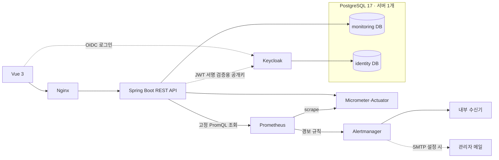
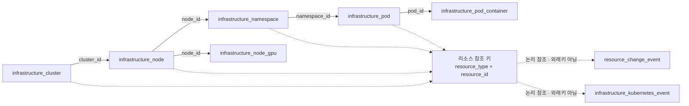

# Infrastructure Monitoring Service

15만 Pod 규모의 인프라 시나리오 데이터를 PostgreSQL에 저장하고, 계층 탐색·검색·상세 확인·상태 변화를 제공하는 모니터링 웹 애플리케이션입니다. Keycloak 사용자 인증과 Prometheus 기반 운영 관측도 포함합니다. 초기 데이터는 제공된 배치로 준비합니다.

> 탐색은 과제에서 정한 `Cluster → Node → Namespace → Pod` 모델을 따릅니다. Node 아래 Namespace 단위로 실행 중인 Pod를 좁혀 가는 드릴다운 조회를 제공합니다.

## 프로젝트 실행 방법

### 1. 실행 준비

Docker Engine/Desktop와 Docker Compose v2, Python 3.9+를 준비하고 Docker를 실행합니다. 프로젝트 폴더에서 다음 단계를 진행합니다. Java·Node.js와 DB는 컨테이너 안에서 실행되므로 별도로 설치하지 않아도 됩니다.

첫 빌드에는 이미지·의존성 다운로드를 위한 인터넷 연결이 필요합니다. 서비스가 사용하는 로컬 포트 `5176`, `8083`, `8183`, `9095`, `9195`가 비어 있어야 합니다.

### 2. 서비스와 초기 데이터 준비

```bash
python3 scripts/auth-local.py
```

명령 하나로 초기 데이터베이스·인증·초기 데이터를 준비하고 웹 서비스를 실행합니다. 이 명령은 브라우저 창을 자동으로 열지는 않습니다. 완료 안내가 나오면 아래 주소를 브라우저에서 열어 주세요. 별도의 프론트엔드 실행 명령은 필요하지 않습니다.

1. PostgreSQL과 서비스용·인증용 DB를 생성하고 Flyway 마이그레이션을 적용합니다.
2. Cluster 20개, Node 200개, Namespace 2,000개, **Pod 150,000개**를 적재합니다.
3. Keycloak에 초기 계정 `admin`, `user1`, `user2`와 역할·Cluster 권한을 등록합니다.
4. 백엔드·프론트엔드·Prometheus·Alertmanager·내부 알림 수신기를 기동하고 API와 OIDC 준비 상태를 확인합니다.

`Authentication environment ready`가 표시되면 [http://127.0.0.1:5176](http://127.0.0.1:5176)에 접속합니다.

스크립트는 Docker Compose를 사용해 아래 **상시 서비스 7개**를 실행합니다. `db-init`, `auth-import`, `seed`는 초기 준비에만 쓰이는 일회성 작업 컨테이너이며, 완료 코드 0으로 종료되는 것이 정상입니다.

| 상시 서비스 | 역할 |
|---|---|
| `frontend` | 빌드된 Vue 화면을 NGINX로 제공하고 `/api` 요청을 백엔드로 전달 |
| `backend` | Spring Boot API, 인증·권한 검증, PostgreSQL 조회, 상태 갱신 |
| `db` | PostgreSQL 서버 1개 안에서 학습/모니터링 DB와 Keycloak identity DB 제공 |
| `keycloak` | OIDC 로그인, 사용자·역할·Cluster 그룹 정보 제공 |
| `prometheus` | 백엔드 Actuator/Micrometer 지표를 주기적으로 수집하고 보관·경보 평가 |
| `alertmanager` | Prometheus 경보 그룹화·반복·해소 알림을 내부 수신기와 선택한 SMTP로 전달 |
| `alert-receiver` | Alertmanager 알림을 앱과 독립적으로 받아 최근 이벤트를 제한 보관하고 메일 설정을 중계 |

### 3. 로그인

초기 로컬 계정의 비밀번호는 모두 **`1234`**입니다.

| 계정 | 비밀번호 | 접근 범위 | Pod 수 | 운영 관측 |
|---|---|---|---:|---|
| `admin` | `1234` | 전체 Cluster | 150,000 | 가능 |
| `user1` | `1234` | Cluster 1~10 | 100,000 | 불가 |
| `user2` | `1234` | Cluster 11~20 | 50,000 | 불가 |

세 계정은 로컬 테스트용이며 서비스는 로컬 주소에만 노출됩니다. DB·Keycloak 초기화 관리자·내부 제어용 비밀값은 실행 시 별도 생성됩니다.

### 4. 기능 확인

`admin`으로 로그인해 상단 리소스 건수와 Cluster 목록을 확인합니다. 왼쪽 계층에서 Cluster → Node → Namespace → Pod를 펼치고, Pod를 선택해 상세·변경 이력을 확인합니다. 이름 검색과 상태·Cluster·Namespace 범위 필터를 적용한 뒤 검색 결과의 계층 위치로 이동할 수 있습니다.

자동 갱신을 켜면 상태 변화가 화면에 반영됩니다. 선택형 시뮬레이터는 5초마다 Cluster 1개·Node 5개·Namespace 10개·Pod 100개를 차례로 갱신합니다. 15만 Pod 전체를 5초마다 바꾸지 않으며 Pod ID 전체 순환은 약 125분입니다. 화면 폴링은 이와 별도입니다. Node 상세에는 용량·할당 가능량·Pod CPU·메모리 요청량·현재 사용량과 GPU 장치 정보가, Pod 상세에는 컨테이너별 상태·CPU/메모리 요청과 사용량이 표시됩니다. 이벤트 펼침에서 현재 상태 이벤트를 확인할 수 있습니다. `운영 관측`에서는 Prometheus가 수집한 API·DB·JVM 지표, 추이 차트와 경보를 확인합니다. 로그아웃 후 `user1`, `user2`로 로그인하면 각각 10만·5만 Pod의 조회 범위와 관리자 메뉴 접근 제한을 확인할 수 있습니다.

#### 관리자 메일 알림 (선택)

기본 구성에는 SMTP 계정이나 앱 비밀번호가 포함되지 않습니다. 메일 발송을 사용하려면 STARTTLS SMTP 서버의 주소·발신 주소·사용자명·앱 비밀번호를 로컬에 등록합니다. SMTP 설정 없이도 웹 화면, 수집 지표, Prometheus 경보, 내부 알림 수신기는 동작합니다.

1. 먼저 위 명령으로 서비스를 실행합니다.
2. 프로젝트 루트에서 `python3 scripts/configure-alert-email.py`를 실행하고, 프롬프트에 SMTP 정보 네 가지를 입력합니다. 비밀번호 입력은 화면에 표시되지 않습니다.
3. `python3 scripts/auth-local.py`로 구성을 반영해 재기동합니다.
4. `admin`으로 운영 관측을 열고 **관리자 메일** 팝업에서 수신 주소와 메일 받기를 저장합니다.

SMTP 구성은 프로젝트 루트의 Git 제외 `.local/auth/smtp.json`에 권한 0600으로 저장됩니다. 비밀정보를 Git에 추가하거나 다른 사람과 공유하지 마세요. 앱은 단일 관리자 수신 주소와 발송 활성 여부만 저장합니다. Alertmanager가 SMTP로 메일을 보내며, 화면의 경보 발생은 메일함 배달을 보장하지 않습니다.

### 5. 실행 상태 확인과 종료

```bash
docker compose --env-file .local/auth/compose.env -f compose.auth.yaml ps --all
docker compose --env-file .local/auth/compose.env -f compose.auth.yaml stop
```

7개 상시 서비스가 실행되고, 초기 설정·데이터 적재를 담당하는 `db-init`, `auth-import`, `seed`가 종료 코드 0이면 정상입니다. `stop`은 데이터를 보존합니다. 다시 실행할 때는 2단계 명령을 사용하면 됩니다. 재시작 시 기존 데이터와 계정 설정을 재사용합니다.

데이터를 보존하며 멈출 때는 `docker compose --env-file .local/auth/compose.env -f compose.auth.yaml stop`을 사용합니다. `down -v`는 DB 볼륨의 데이터를 삭제하므로 데이터가 필요하면 사용하지 마세요.

## 사용한 기술 및 선택 이유

| 기술 | 적용 이유 |
|---|---|
| Java 21 · Spring Boot 3.5 · Gradle | REST API와 서버 정책을 타입이 명확한 단일 백엔드로 구현하고, Gradle Wrapper로 빌드 환경을 고정합니다. |
| PostgreSQL 17 · JPA/Hibernate · Flyway | 대량 계층·상태·변경 이력을 영속화하고, 관계 조회·인덱스·스키마 이행을 실제 DB에서 검증합니다. |
| Vue 3 · TypeScript · Vite | 계층 탐색과 상세·필터 화면을 상태가 분리된 UI로 구성하고, 응답 타입을 정적으로 확인합니다. |
| NGINX | 빌드된 프론트엔드 정적 자산을 제공하고 브라우저의 `/api` 요청을 백엔드로 전달합니다. |
| Keycloak · OAuth2/OIDC | 애플리케이션과 인증 서버를 분리하고, 로그인 토큰의 사용자·역할·Cluster 접근 범위를 검증합니다. |
| Micrometer · Actuator · Prometheus · Alertmanager | 애플리케이션 지표 수집, 시계열 조회, 경보 평가와 알림 전달을 각각 분리합니다. |
| Docker Compose | 웹·API·DB·인증·관측 서비스를 의존 순서에 맞춰 함께 실행합니다. |
| Jenkins | 특정 Git 커밋을 별도 작업 폴더에 받아 서버·화면·실제 DB·로그인 테스트와 이미지 빌드를 실행하고 결과를 수집합니다. |
| JUnit 5 · Mockito · Testcontainers · Vitest · Playwright | 서버 단위/실제 PostgreSQL 통합, 프론트 상태/브라우저 동작을 각 경계에서 검사합니다. |

## 프로젝트 구조

```text
backend/       Spring Boot API, JPA 도메인, 인증, 계측
frontend/      Vue 화면, API 클라이언트, 가상 리스트
scripts/       초기 데이터 적재, 로컬 실행, 검증 도구
infra/         Prometheus·Alertmanager 설정
compose.auth.yaml  인증 포함 통합 실행 구성과 기동 순서
Jenkinsfile    Jenkins 검증 파이프라인
docs/          API·설계·운영·성능 검증 문서
```



## 구현한 기능

| 기능 | 동작 |
|---|---|
| 계층 탐색 | Cluster → Node → Namespace → Pod를 펼쳐 하위 리소스를 지연 조회합니다. |
| 리소스 상세 | 이름·상태·갱신 시각과 경로, 유형별 진단 정보를 표시합니다. Node는 용량·할당·사용량과 GPU, Pod는 컨테이너별 상태·요청/사용량·재시작 정보를 제공합니다. |
| 리소스 이벤트 | 현재 리소스 상태에 연결된 reason·message·최초/최근 발생 시각·반복 횟수를 표시합니다. 정상 상태로 돌아오면 현재 이벤트가 제거됩니다.  |
| 검색·필터 | 이름·유형·상태·Cluster·Namespace로 좁히고 검색 결과에서 계층 위치로 이동합니다. |
| 상태 갱신·이력 | 수동 새로고침과 5초 주기 폴링으로 상태를 갱신하고, 변경 이력에서 이전·이후 값을 확인합니다. |
| 사용자별 접근 | Keycloak 로그인과 서버 권한 검증으로 user1/user2의 Cluster 조회 범위를 제한합니다. ADMIN은 전체 리소스와 운영 관측에 접근합니다. |
| 운영 관측·알림 | 관리자 화면에서 Prometheus가 수집한 API/DB/JVM 지표와 경보를 확인합니다. Alertmanager는 내부 수신 경로에 전달하고 SMTP 설정 시 관리자 메일도 보냅니다. |

### 추가 구현 항목

기본 계층 탐색·검색·상태 필터·갱신에 더해, 여러 Cluster를 운영하면서 대상과 장애 원인을 찾고 서비스 자체의 상태까지 확인할 수 있도록 다음 기능을 추가했습니다.

| 추가 항목 | 구현 내용 | 추가한 이유 |
|---|---|---|
| 리소스별 진단 정보 | Node의 CPU·메모리 용량/할당/사용량과 GPU 장치, Pod의 컨테이너별 준비 상태·재시작·요청/사용량, 현재 이벤트를 제공합니다. | 정상/경고/오류 표시만으로 부족한 원인 확인에 필요한 정보를 상세 화면에 모으기 위해서입니다. |
| 상태 변경 이력 | 변경 시각과 이전·이후 상태/속성을 저장하고 상세 화면에서 조회합니다. | 현재 상태만으로는 확인하기 어려운 반복적인 상태 전환과 사용량 변화를 확인하기 위해서입니다. |
| 로그인·사용자별 조회 권한 | Keycloak OIDC 로그인과 서버 JWT 검증을 적용하고, 사용자별 Cluster 범위 및 관리자 전용 API·메뉴를 구분합니다. | 같은 서비스를 사용하더라도 담당 Cluster와 운영 정보의 접근 범위를 분리하기 위해서입니다. |
| 관리자 운영 관측 | Prometheus에서 API 오류·응답 지연·DB 조회·JVM 메모리·연결 풀 지표를 조회하고 카드와 추이 차트로 표시합니다. | 관리 대상뿐 아니라 모니터링 서비스의 요청 지연과 자원 상태도 확인하기 위해서입니다. |
| 경보와 관리자 메일 | Prometheus 규칙으로 경보를 평가하고 Alertmanager가 발생·해소 알림을 내부 수신기로 전달합니다. 관리자 메일 등록 팝업과 선택형 SMTP 전송도 제공합니다. | 화면을 계속 보고 있지 않아도 수집 중단·오류 증가·상태 갱신 실패를 알 수 있도록 하기 위해서입니다. |
| Jenkins 통합 검증 | Git 커밋을 고정해 서버·프론트·실제 PostgreSQL·로그인/권한·이미지 빌드와 장애/해소 알림 경로를 검증합니다. | 코드 테스트뿐 아니라 인증·DB·컨테이너 설정의 조합에서 발생하는 문제를 배포 전에 확인하기 위해서입니다. |

GPU는 전체 200개 Node 중 짝수 번호 100개에 2개씩, 총 200개가 배정됩니다. 예를 들어 `node-002`를 선택하면 상세의 GPU 장치 영역에서 두 장치를 확인할 수 있고 `node-001`에는 GPU가 없습니다.

## 구현 과정에서 고려한 사항

- **첫 화면의 작업량 축소:** Cluster 첫 페이지를 우선 표시하고 상세·이력·운영 화면 모듈은 해당 화면에 들어갈 때 브라우저가 요청합니다. 전체 건수 집계가 첫 목록 표시를 지연시키지 않도록 요청을 분리했습니다.
- **서버와 브라우저의 자원 상한:** DB 조회는 필요한 열과 최대 100개 응답으로 제한하고, 브라우저는 최근 500개 목록과 화면에 보이는 행만 유지합니다. 데이터 규모가 늘어도 전체 행 수에 비례해 DOM과 캐시가 늘어나지 않게 했습니다.
- **주기적 폴링:** 현재 상태를 확인하는 조회 화면에 맞춰 요청 단위로 완료되는 REST 폴링을 사용합니다. 스트리밍에 필요한 지속 연결·사용자별 구독·재연결 후 이벤트 복구를 별도로 관리하지 않고 기존 인증·권한·페이지 조회 API를 재사용합니다. 조회 범위와 간격으로 요청량을 조절하고, 화면을 보지 않을 때 중단하기도 쉽습니다. 상태 조회와 전체 집계의 갱신 주기를 구분해 전체 데이터 집계를 반복하지 않도록 했습니다.
- **조회량 제한:** 현재 목록·펼친 계층·선택 상세는 기본 5초 간격으로 갱신합니다. 상단 카드와 사이드바의 전체 건수는 로그인 계정의 권한 범위로 집계하고, 마지막 집계 완료 후 1분이 지난 다음 조회 주기에 다시 확인합니다. 집계 요청도 같은 갱신 작업 안에서 실행해 중복 실행을 막고 필터·선택·스크롤을 유지합니다. 탭 숨김·오프라인·자동 갱신 해제 시에는 멈추고 실패한 집계는 기존 숫자를 유지하며 오류를 표시합니다.
- **사용자별 조회 통제:** 서버가 JWT의 서명·발급자·역할을 확인하고 Cluster 접근 조건을 목록·상세·검색·집계에 적용합니다. 브라우저에서 다른 Cluster ID를 보내더라도 허용 범위를 벗어난 데이터를 조회할 수 없습니다.
- **운영 지표와 경보:** Prometheus로 API 오류·응답 시간·DB 조회 지연·JVM 메모리·연결 풀을 수집합니다. 관리자 화면에서 현재 지표·추이·경보 상태를 확인하고 수집 중단·API 오류 증가·상태 갱신 실패가 경보 조건을 충족하면 Alertmanager가 내부 수신기와 등록된 관리자 메일로 발생·해소 알림을 전달합니다.

## 설계 문서 필수 포함 항목 4가지

### 프론트엔드 렌더링 전략

고정 높이 행을 사용하는 화면에 맞춰 스크롤 위치·행 높이로 표시 범위를 계산하고, 뷰포트 앞뒤 여유 행만 추가 렌더링합니다. 계층 자식은 펼칠 때 가져오며 목록 캐시는 최대 5페이지·500개, 계층 캐시는 24페이지·동시 펼침 8개로 제한합니다. 새 페이지를 받으면 오래된 캐시를 제거하면서 스크롤 위치를 보정합니다. 갱신은 기존 행 키·선택·스크롤을 유지하며 현재 화면에 필요한 데이터만 교체합니다.

### 계층 데이터 모델링

계층의 종류와 깊이가 4단계로 고정되고 유형별 속성이 달라 **유형별 테이블과 직접 부모 외래키**로 설계했습니다. 유형별 필드·상태 제약을 각 테이블에 두고, 부모 ID 조건으로 하위 페이지를 조회합니다.



실선은 DB 외래키 관계이고 점선은 `resource_type + resource_id`로 리소스 유형 중 하나를 가리키는 논리 관계입니다. 이벤트 조회에서는 실제 리소스와 사용자 권한을 다시 확인합니다.

| 테이블 | 주요 열·제약 |
|---|---|
| `infrastructure_cluster` | `id` PK, 이름 UNIQUE, 상태, 갱신 시각 |
| `infrastructure_node` | `id` PK, `cluster_id` FK, 이름/상태/갱신 시각, CPU·메모리 사용률·용량·할당 가능량·요청량. Cluster 안 이름 UNIQUE |
| `infrastructure_namespace` | `id` PK, `node_id` FK, 이름/상태/갱신 시각. Node 안 이름 UNIQUE |
| `infrastructure_pod` | `id` PK, `namespace_id` FK, 이름/상태/갱신 시각, 재시작 수·컨테이너 수·대표 이미지·워크로드 이름. Namespace 안 이름 UNIQUE |
| `infrastructure_pod_container` | `id` PK, `pod_id` FK `ON DELETE CASCADE`, 이름·이미지·상태·준비 여부·재시작·CPU/메모리 요청/사용량. `(pod_id,name)` UNIQUE |
| `infrastructure_node_gpu` | `id` PK, `node_id` FK `ON DELETE CASCADE`, 장치 이름·모델·메모리·사용률·온도·할당 Pod 수. `(node_id,device_name)` UNIQUE |
| `infrastructure_kubernetes_event` | `id` PK, 유형·리소스 ID·경보 종류·reason/message·처음/최근 관측 시각·반복 수. 리소스별 현재 상태 이벤트 한 건을 `(resource_type,resource_id)`로 식별 |
| `resource_change_event` | `id` PK, 유형·리소스 ID·변경 시각·이전/이후 상태·JSONB 속성. 현재 값과 별도로 변경 전후 기록 |

이벤트와 변경 이력의 `resource_type + resource_id`는 여러 유형을 가리키는 다형 참조여서 단일 FK는 만들지 않았습니다. 조회 시 허용된 유형 테이블과 JOIN하고 리소스 존재 및 사용자 권한을 다시 확인합니다.

Node는 CPU·메모리 용량/할당량, Pod는 재시작·이미지 정보를 각 테이블의 타입 있는 열에 보관합니다. Pod 컨테이너와 Node GPU 장치는 별도 자식 테이블입니다. `infrastructure_kubernetes_event`는 선택 리소스의 현재 상태 이벤트 한 건을 보관하고, `resource_change_event`는 상태 전환 전후를 기록합니다. 부모 연결은 외래키, 부모 내부 이름 중복은 유일 제약으로 막습니다. Namespace는 이 과제의 Node별 탐색 단위이므로 같은 이름이 서로 다른 Node 아래 존재할 수 있습니다.

목록 응답에 전체 자식 Entity를 포함하지 않습니다. 부모 관계 JOIN으로 경로와 Cluster 접근 범위를 구해 조회하며, 하위 데이터는 사용자가 펼쳤을 때 페이지 단위로 가져옵니다. 컨테이너·GPU 장치 정보는 해당 Pod/Node를 선택했을 때만 제한 조회합니다.

### 인덱스 및 쿼리 전략

화면이 `다음 페이지`로 순차 탐색하고 임의 페이지 번호를 제공하지 않아 `id > 마지막으로 본 ID ORDER BY id LIMIT n+1` keyset 커서를 사용합니다. 깊은 페이지에서도 앞선 행을 OFFSET만큼 읽고 버리는 작업 없이 다음 범위부터 조회합니다. 새 행은 현재 커서 뒤에서 이어집니다. 페이지 번호를 직접 지정하거나 특정 위치로 점프하는 기능은 없습니다. 커서는 검색·상태·부모·Cluster·사용자 범위에 묶이며 조건 변경 시 새로 시작합니다. 이 방식은 여러 페이지를 하나의 DB snapshot으로 고정하지 않으므로 동시 변경이 있으면 페이지 간 결과가 한 시점의 스냅샷이라는 보장은 없습니다. `(부모 ID, ID)`는 기본 하위 목록을, `(부모 ID, 상태, ID)`는 상태 필터 목록을 지원합니다. 전체 상태 목록에는 `(상태, ID)`를 둡니다. PostgreSQL `pg_trgm` GIN 인덱스는 이름 중간 부분 검색에, 자식 상세는 부모 ID 인덱스에 사용합니다. 현재 이벤트 조회는 `(resource_type, resource_id, last_seen DESC)`와 최신 시각 인덱스를 사용합니다.

JPA/Hibernate DTO projection으로 필요한 열만 읽고, `limit + 1`개를 조회해 전체 count 없이 다음 페이지 존재 여부를 판단합니다. 응답은 최대 100개이며 Entity 그래프 로딩을 피합니다. 실제 PostgreSQL 통합 테스트에서 목록 SQL 횟수와 Entity 로딩 0건을 확인했고, 선택적 이름 검색에서 `pg_trgm` 인덱스가 사용되는 실행 계획을 확인했습니다.

### API 설계

목록은 공통 요약 정보만 반환하고, 유형별 진단 속성과 경로는 선택한 리소스의 상세 응답에서 제공합니다. 검색 결과에는 조상 경로를 함께 반환해 결과마다 경로 API를 다시 호출하는 요청 증가를 줄였습니다.

리소스 변경 이력은 `GET /api/resources/{type}/{id}/events`, 현재 상태 이벤트는 `GET /api/resources/{type}/{id}/kubernetes-events?limit=20`에서 조회합니다. 이벤트 목록은 최대 20개이며, 사용자별 Cluster 권한을 다시 확인합니다.

다음 페이지 응답의 `nextCursor`는 마지막 조회 위치를 나타내는 값입니다. 클라이언트가 이를 다음 요청에 보내면 서버는 그 뒤의 데이터를 조회합니다. 검색·상태·부모·Cluster 범위나 로그인 계정이 바뀌면 이전 커서를 사용할 수 없습니다. 다른 조건이나 다른 계정의 커서를 재사용하면 거부하며, 요청 파라미터와 별개로 모든 쿼리에 서버가 확인한 권한을 적용합니다. 오류는 ProblemDetail로 통일하고 잘못된 입력 400·조회 불가 404·저장소 장애/시간 초과 503을 구분합니다. 리소스 상세와 상태 이벤트 조회도 같은 사용자별 Cluster 범위를 확인합니다.

## 성능 측정 결과

프로덕션 빌드·PostgreSQL의 150,000 Pod·관리자 인증 화면에서 측정했습니다. Apple M1 Pro/16GB, **Chrome 155.0.8059.80의 DevTools Performance 탭·CPU 4× slowdown·캐시 비활성화·네트워크 제한 없음** 조건입니다.

첫 화면은 인증 복귀 문서의 navigation 시작부터 Cluster 목록이 표시되어 조작 가능한 시점까지입니다. 첫 목록 표시 후 사용자 표시 정보·계층 루트·전체 건수를 조회해 초기 작업을 분산했습니다. 계층은 클릭부터 하위 행 표시/제거까지, 검색은 디바운스 이후 요청부터 결과 표시까지, 필터는 선택 확정부터 결과 표시까지 측정했습니다. 갱신은 클릭/폴링 요청부터 목록·선택 상세 반영까지이며 5초 폴링 대기 시간은 제외합니다. 각 종료점에서 두 animation frame을 확인하고 User Timing을 Performance의 Timings 트랙에 표시했습니다.

| 항목 | 목표 | Chrome Performance 기록값 | 판정 |
|---|---:|---:|---|
| 인증 복귀 후 첫 Cluster 목록 | 500ms | 459.30ms | 충족 |
| 최초 계층 펼침(네트워크 포함) | 100ms | 87.80ms | 충족 |
| 캐시된 계층 재펼침 | 100ms | 48.40ms | 충족 |
| 계층 접기 | 100ms | 37.98ms | 충족 |
| 이름 검색 | 300ms | 134.85ms | 충족 |
| 상태 필터 | 200ms | 172.60ms | 충족 |
| 변경 없는 새로고침 | 200ms | 57.96ms | 충족 |
| 상태 변경 후 새로고침 | 200ms | 122.10ms | 충족 |
| 상태 변경 후 자동 갱신 | 200ms | 75.90ms | 충족 |

표의 값은 아래 Chrome Performance 원본에 표시된 이벤트 Duration입니다. 첫 화면·최초 펼침·검색·필터는 1080×1288, 나머지는 1080×1769 뷰포트에서 기록했습니다. 최초 펼침은 네트워크 요청을 포함합니다. 변경 갱신은 목록과 선택 상세의 상태 일치 및 목록 공백이 발생하지 않는 것을 확인하고 테스트 DB 값을 복원했습니다.

| 화면·자원 측정 | 결과 |
|---|---|
| Chrome FPS 미터 | 15초 스크롤 중 시작·중간·후반 91.2 / 97.2 / 96.0fps |
| 15초 스크롤 보조 계측 | RAF 평균 87.68fps, 1초 구간 최저 69fps |
| Chrome 작업 관리자 | 대상 탭 90.8MB, 참고 기준 300MB 이하 |

FPS 미터는 세 시점의 직접 관측이며, RAF는 별도 보조 지표입니다. 미터의 전체 구간 최솟값을 저장한 결과는 아닙니다. 작업 관리자 메모리도 별도 시점의 스냅샷입니다.

<details>
<summary>Chrome DevTools 목표별 원본 캡처</summary>

CPU 4×와 캐시 비활성 조건:


최초 Cluster 목록:


계층 펼침·접기:


검색·필터:


수동·자동 갱신:


스크롤·메모리:


</details>

### 반복 검증

Chrome155.0.8059.85·1440×1000·CPU4×·캐시 비활성 조건에서 실제 PKCE 로그인과 ADMIN의15만 Pod 조회를 확인했습니다. 자동 반복20회에서 모든 응답 목표를 충족했고 API 오류·측정 오류는0건입니다. 자동 변경 갱신은3회이며 테스트 DB 상태·시각 복원을 완료했습니다. 이 반복 통계는 위 Chrome Performance 원본 이벤트 기록과 구분합니다.

<details>
<summary>20회 반복 검증 결과</summary>

| 항목 | 표본 | P95 | 최댓값 | 판정 |
|---|---:|---:|---:|---|
| 첫 화면(SSO 포함) | 20 | 268.99ms | 272.75ms | 충족 |
| 인증 복귀 후 목록 | 20 | 164.70ms | 172.60ms | 충족 |
| 최초 계층 펼침 | 20 | 58.10ms | 60.70ms | 충족 |
| 접기 | 20 | 28.90ms | 29.00ms | 충족 |
| 캐시 재펼침 | 20 | 29.60ms | 30.00ms | 충족 |
| 검색 | 20 | 67.30ms | 69.00ms | 충족 |
| 필터 | 20 | 49.40ms | 50.30ms | 충족 |
| 새로고침 | 20 | 74.90ms | 91.50ms | 충족 |
| 변경 반영 새로고침 | 20 | 62.00ms | 62.00ms | 충족 |
| 변경 반영 자동 갱신 | 3 | 58.20ms | 58.20ms | 충족 |

10초 스크롤 보조 계측은 compositor59.92fps·RAF평균60.00fps·1초 구간 최저60fps였고, 표시 DOM은19행입니다. native FPS 미터·작업 관리자 결과와 별도로 기록했습니다.

</details>

자동 반복 검증은 다음 명령으로 실행합니다.

```bash
PERF_BROWSER=chrome PERF_FULL=1 PERF_REPETITIONS=20 PERF_LABEL=<새-이름> python3 scripts/test-auth.py --performance
```

## 아쉬운 점 및 개선하고 싶은 부분

- **실제 인프라 지표 수집:** 실제 운영 경로에서는 생성 데이터 시뮬레이터를 함께 켜지 않고 Kubernetes API의 현재 상태/요청 정의, kubelet/cAdvisor의 CPU·메모리 시계열, DCGM Exporter의 GPU 시계열로 대체합니다. Cluster/Node/Namespace/Pod 식별자를 일관된 label로 맞추고 scrape 성공·최근 수집 시각·대상별 오류를 화면에서 확인합니다. 시계열은 Prometheus, 리소스 관계·권한 정보는 서비스 DB에서 조회합니다.
- **운영 알림함:** Alertmanager 알림을 화면 상단 종 아이콘과 미확인 건수로 보여주고, 발생/해소 시각·심각도·대상 리소스·읽음/확인 상태를 저장하는 기능을 추가할 수 있습니다. 알림을 선택하면 해당 리소스 상세로 이동합니다. 현재 내부 수신기는 최근 알림을 프로세스 메모리에 보관하므로, 화면을 닫거나 서버가 재시작된 뒤에도 다시 확인할 수 있도록 알림 DB 저장과 Alertmanager fingerprint 기반 중복 수신 처리가 먼저 필요합니다. 메일은 보조 전달 채널로 둡니다.
- **계정 운영:** 현재 로컬 계정은 미리 만든 세 계정만 제공하고 가입·비밀번호 재설정·프로필 변경은 지원하지 않습니다. 실제 조직에서는 사용자·조직 동기화, 계정 비활성화, 역할·Cluster 범위 변경 이력, 변경 권한을 관리자에게 제한하는 절차를 추가합니다.
- **조회량 확장:** 현재 15만 Pod에서 집계·검색을 실제 DB로 확인했습니다. 데이터 규모와 동시 사용자가 늘어날 때는 Cluster 집계와 짧은 검색어의 실행 계획, 데이터 갱신 중 페이지 이동 결과를 다시 측정하고 병목이 확인된 항목만 별도 집계나 검색 정책으로 조정합니다.
- **관측 대상 확장:** 현재 Prometheus는 Spring Boot 지표를 수집합니다. 운영 단계에서 PostgreSQL, Keycloak, 호스트·컨테이너와 실제 Kubernetes/GPU collector까지 함께 감시하면 요청 지연의 원인을 앱·DB·인프라 수집 경로로 나눠 볼 수 있습니다.
- **워크로드 중심의 장애 분석:** Deployment·StatefulSet·DaemonSet·Job과 소속 Pod를 연결하고, 목표/준비 복제본과 배포 상태를 확인하는 화면으로 확장하고 싶습니다. 문제가 있는 Pod에서 현재·직전 종료 컨테이너 로그와 관련 이벤트를 함께 조회해 애플리케이션 단위로 장애 원인을 좁힐 수 있도록 합니다.
- **네트워크·스토리지 연결 관계:** Service·EndpointSlice·Ingress와 대상 Pod, PVC·PV의 연결 상태를 함께 보여주고 싶습니다. Pod 상태만으로 드러나지 않는 연결 대상 누락이나 볼륨 연결 실패를 관련 리소스까지 이어서 확인하는 방향입니다.
- **자원 배정·스케줄링 진단:** 실제 CPU·메모리·GPU 요청량과 할당 가능량, Namespace별 ResourceQuota를 비교하고 Pending Pod의 이벤트·Node 조건을 연결하고 싶습니다. 단순 사용률 표시를 넘어 자원 부족이나 배치 조건 때문에 실행되지 못하는 원인을 확인하도록 확장합니다.
