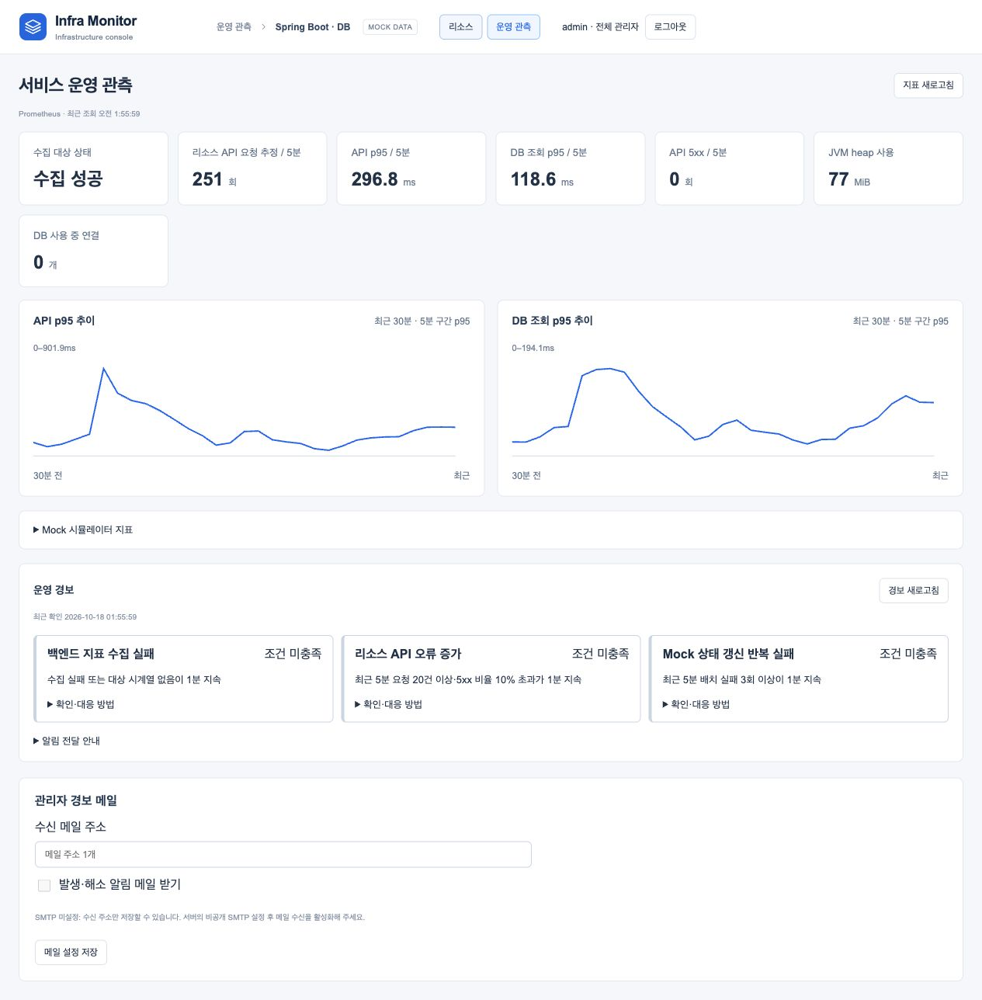

# 관리자 경보 메일

## 목적과 구조

운영 관측의 ADMIN은 경보 카드 우측의 **관리자 메일** 버튼(경보 새로고침 왼쪽)을 눌러 팝업에서 서비스 공통 수신 주소 한 개와 발송 여부를 설정합니다. 사용자별 구독 기능은 아닙니다. **Alertmanager의 기본 email_configs가 직접 SMTP로 전송**하며 백엔드가 메일을 대신 보내지 않습니다.

관리자 화면 → JWT/ADMIN 검증 → 설정 API → 내부 제어 토큰 검증 → 설정 파일 교체/reload → Alertmanager SMTP 전송으로 연결합니다. 기존 웹훅·그룹화·반복 간격·억제·해소 알림은 유지합니다. 화면의 firing이나 설정 저장 성공은 실제 메일 배달 확인이 아닙니다.

## 설정 방법

1. `python3 scripts/auth-local.py`로 인증 환경을 시작합니다.
2. admin으로 운영 관측의 **관리자 경보 메일**에서 수신 주소를 저장합니다. SMTP가 없으면 주소만 저장하고 발송 활성화는 차단합니다.
3. 로컬 터미널에서 `python3 scripts/configure-alert-email.py`를 실행합니다. SMTP host:port·발신 주소·SMTP 계정·앱 비밀번호를 숨김 입력합니다. 인자·출력·Git에 비밀값을 넣지 않습니다.
4. `python3 scripts/auth-local.py`로 설정을 반영한 뒤 **발생·해소 알림 메일 받기**를 체크하고 저장합니다. 이미 발생 중인 경보가 있다면 설정 적용 후 발송될 수 있습니다.

시작 스크립트는 SMTP 파일의 수정 시각(비밀 내용/해시 아님)을 Compose 설정 버전으로 사용합니다. 파일 변경 시 수신기와 Alertmanager를 모두 다시 생성하며 수신기 health 이후 Alertmanager를 시작해 이전 프로세스의 설정이 남지 않게 합니다. SMTP 비밀값은 설정 버전·레이블·출력에 넣지 않습니다.

STARTTLS를 지원하는 SMTP 서버(통상 587)가 필요합니다. implicit TLS 전용 465는 이 구성 대상이 아닙니다. 현재 로컬 `.local/auth/smtp.json`에는 사용자가 지정한 Auknowlog의 비공개 SMTP 설정을 참조해 인증 정보를 반영했습니다. 발신 주소는 SMTP 사용자명 설정을 사용합니다. 값은 이 문서·Git·명령 출력에 기록하지 않습니다. Alertmanager 준비 상태(HTTP 200), 수신기 설정(`smtpConfigured=true`)과 TLS 이메일 설정을 확인하고 합성 firing/resolved 알림 2건이 SMTP에 수락됐습니다. 실패 카운터는 0입니다. 이는 SMTP 서버의 수락 확인이지 최종 편지함 도착/열람 확인은 아닙니다.

## 저장·보안·실패 경계

- 인증 Compose에만 연결합니다. GET/PUT `/api/operations/alert-email`은 ADMIN 전용, 익명 401·VIEWER 403이며 비인증 모드에는 endpoint가 없습니다.
- 응답은 recipient·enabled·smtpConfigured·available만 포함합니다. SMTP 계정/암호·내부 제어 토큰은 화면에 전달하지 않습니다. 단일 일반 주소만 허용하고 표시 이름·복수 주소·CRLF를 거부합니다.
- SMTP는 Git 제외 `.local/auth/smtp.json` 0600에 저장하며 초기화 작업이 별도 비밀 볼륨으로 복사합니다. 백엔드에는 SMTP 비밀값 대신 내부 제어 토큰만 전달합니다.
- 주소·활성화 상태는 email-config 영속 볼륨에 저장합니다. 앱 DB/Flyway 변경은 없습니다. SMTP 암호는 별도 0600 파일로 두고 Alertmanager의 auth_password_file로 참조합니다. 생성 파일을 로그·문서·캡처에 넣지 않습니다.
- 수신기가 설정 볼륨을 쓰고 Alertmanager는 읽기 전용으로 사용합니다. 설정 endpoint는 고정 내부 URL·공유 토큰·본문 1KiB·요청 시간/응답 크기 제한을 적용합니다. Docker socket은 사용하지 않습니다.
- reload 실패는 이전 파일로 복구하고 오류를 반환합니다. 복구 reload도 실패하면 수동 점검이 필요하며 성공으로 표시하지 않습니다. SMTP 제거 후 재기동하면 이메일은 비활성화하고 웹훅은 유지합니다.
- 별도 SMTP 장애 감지·배달/읽음 보장·관리자 권한 변경 이력은 구현하지 않습니다. Docker/호스트 관리자는 비밀 설정에 접근할 수 있고 직접 운영 포트는 별도 인증 없는 루프백 도구입니다.

## 검증

위 캡처는 수신 주소 입력과 발송 체크박스가 경보 아래에 있던 초기 화면입니다. 현재는 경보 새로고침 왼쪽의 관리자 메일 버튼에서 모달로 엽니다. 실제 주소·SMTP 계정·암호는 캡처에 포함하지 않습니다.

`python3 scripts/test-alert-email.py`는 외부 통신을 차단한 독립 Docker 네트워크와 폐기용 SMTP sink·실제 Alertmanager를 생성합니다. 발생·해소 이메일 각 1건을 확인하고 해당 자원만 정리합니다. fixture는 본문/주소/암호 대신 상태별 건수만 보관합니다. 같은 임시 namespace의 localhost에서만 평문 SMTP를 허용하며 실제 구성은 TLS 필수입니다. 기존 서비스에 장애를 만들거나 외부 메일을 보내지 않습니다.

오프라인 검사는 주소·SMTP 미설정·TLS 기본값·설정 보존·reload 실패 복구·파일 권한을, 서버 검사는 제어 요청·안전한 오류·ADMIN/VIEWER 경계를, 화면 검사는 팝업 진입·닫기·명시적 저장·실패 표시·요청 취소를 확인합니다. `alertmanager_notifications_total{integration="email"}`가 firing/resolved 각 1건 증가했고 실패 카운터는 늘지 않았습니다. SMTP 공급자 수락까지 검증했으며 실제 편지함 도착은 별도로 확인하지 않았습니다.

근거: [Alertmanager 공식 설정](https://prometheus.io/docs/alerting/latest/configuration/)의 email_config·auth_password_file·reload를 사용합니다. [경보 판정·억제·복구](ALERTING_AND_RECOVERY.md)와 구분합니다.
