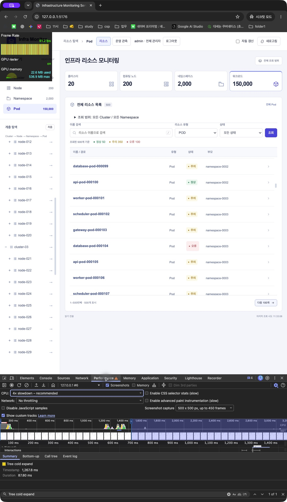
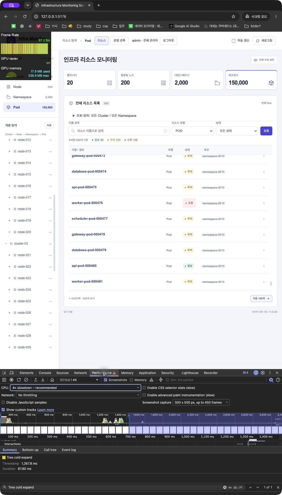
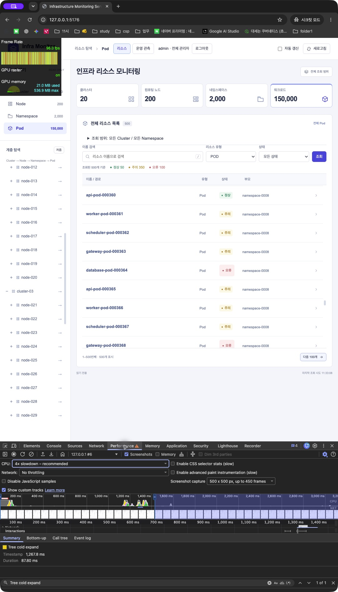

# Chrome DevTools Performance 원본 캡처

## 조건과 구간

Chrome155.0.8059.80·Apple M1 Pro/16GB·인증 Compose 프로덕션 화면·관리자·150,000 Pod에서 CPU4× slowdown·Disable cache·네트워크 제한 없음으로 기록했습니다. 아래 값은 실제 Performance Summary의 이벤트 Duration입니다.

첫 화면은 인증 복귀 문서 navigation부터 실제 Cluster 목록 표시까지, 계층은 클릭부터 하위 행 표시/제거까지입니다. 검색은 디바운스 이후 요청, 필터는 select change, 갱신은 클릭/폴링 요청부터 결과 DOM과 두 RAF까지 측정합니다.

| 항목 | 목표 | Duration | 판정 |
|---|---:|---:|---|
| 첫 Cluster 목록 |500ms|459.30ms|충족|
| 미조회 계층 펼침 |100ms|87.80ms|충족|
| 캐시 재펼침 |100ms|48.40ms|충족|
| 접기 |100ms|37.98ms|충족|
| 검색 |300ms|134.85ms|충족|
| 필터 |200ms|172.60ms|충족|
| 새로고침 |200ms|57.96ms|충족|
| 변경 반영 새로고침 |200ms|122.10ms|충족|
| 변경 반영 자동 갱신 |200ms|75.90ms|충족|

첫 화면·미조회 펼침·검색·필터는1080×1288, 나머지는1080×1769입니다. 표는 원본 이벤트 기록이며 [20회 반복 통계](FINAL_PERFORMANCE_REVIEW.md)와 별도로 제시합니다.

## 실제 원본

## 스크롤·탭 메모리

FPS 미터는15초 스크롤 중 세 시점 관측이고 탭 메모리는 별도 시점입니다. 반복 검증의 CDP/RAF와 구분합니다.

## 재현 순서

1. 실제 관리자 로그인 후 DevTools에서 CPU4×와 Disable cache를 설정합니다.
2. 첫 화면/계층은 제품 코드의 고정 User Timing, 검색/필터/갱신은 테스트 전용 `devtools-user-timing.mjs`를 사용합니다.
3. Record의 Initializing tracing이 끝나 Tracing 상태가 된 뒤 동작합니다. 동작 구간에는 별도의 접근성 트리 조회·빌드·병렬 브라우저 검증을 실행하지 않습니다.
4. 녹화 종료 후 measure를 Find로 선택하고 drawer를 닫아 Summary Duration이 보이는 원본을 저장합니다.
5. 토큰·인증 코드·헤더가 들어갈 수 있는 raw trace/HAR는 공개하지 않으며 측정용 창/도구를 정리합니다.

[측정 프로토콜](PERFORMANCE.md), [최종 반복 결과](FINAL_PERFORMANCE_REVIEW.md)를 참고합니다.
