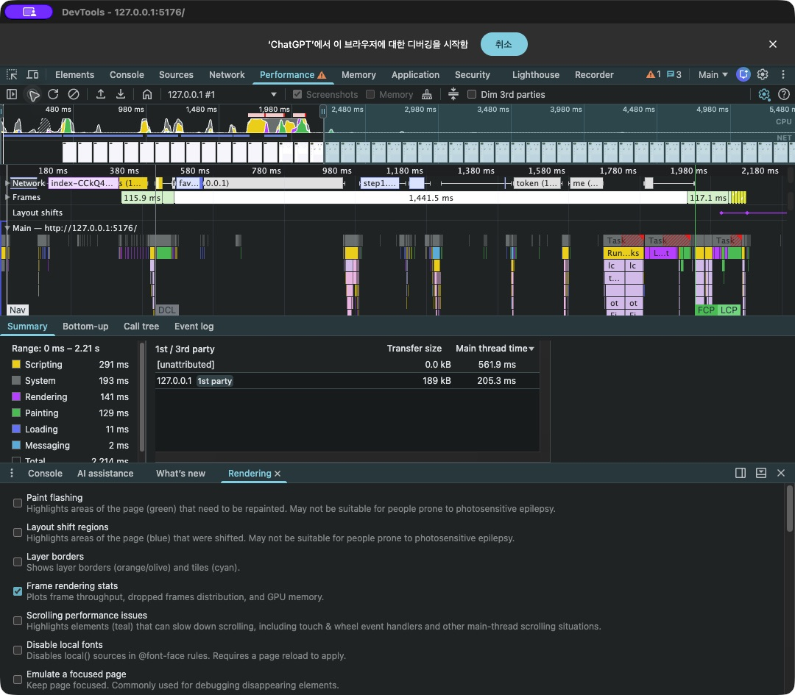
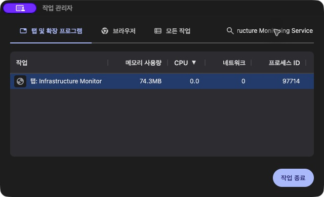
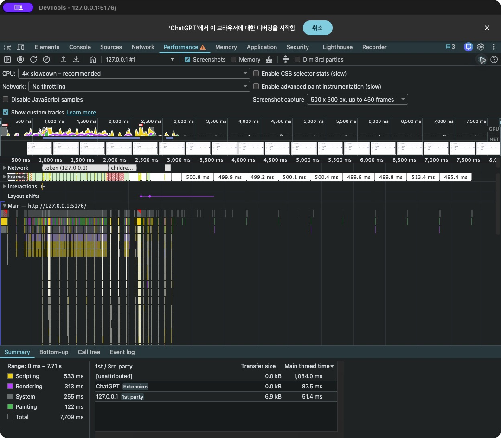

# 실제 Chrome Performance 패널 캡처

## WH-040 재확인과 버전 구분

2026-10-18 설치된 Chrome 바이너리155.0.8059.80과 계속 실행 중인 네이티브 GUI 프로세스153.0.8010.53이 다름을 확인했습니다. 아래 WH-038의 설치 버전 표기를 실제 GUI 프로세스 버전까지 검증한 근거로 사용하지 않습니다. 사용자는 우선 현재 버전 진행을 선택했고 최신 버전 완료를 주장하지 않습니다.

아래 새 이미지는 GUI153의 실제 초기 로드 Record and reload입니다. CPU4x·캐시 OFF를 설정한 후 기록했으며 자동화/확장 비용을 포함합니다. 선택 구간2.214초는 가이드의 개별 동작 결과가 아닙니다. 기록 후 UI의 throttle 값 표기가 달라질 수 있어 이미지 자체만으로 CPU 설정의 독립 증거라고 주장하지 않습니다. 자동 반복은 별도 Chrome155/CDP 설정과 전체 표본을 사용합니다.

실제 Chrome 작업관리자 탭 메모리는74.3MB입니다. 15만 데이터 연결·캐시500개·DevTools 종료 상태이며 CPU4x 반복과는 별도 관측입니다. 보조 heap/RSS가 아닌 실제 도구 수치이며 Chrome FPS 미터 검증을 대신하지 않습니다.

최신 수치·실패·복원은 [최종 재검증](FINAL_PERFORMANCE_REVIEW.md)에 기록합니다. 아래는 최초 캡처 당시의 기록으로 남깁니다.

## WH-038 최초 기록

기록일: 2026-10-18 · 실제 설치된 Google Chrome 155.0.8059.80

## 목적과 조건

반복 측정 수치만이 아니라 실제 DevTools Performance 패널의 CPU·Network·Frames·Main 타임라인을 README에서 확인하도록 원본 화면을 캡처했습니다. 별도로 그린 가상 DevTools 화면이 아닙니다.

- 대상: 현재 인증 화면 5176, ADMIN 로그인, 20 Cluster·200 Node·2,000 Namespace·150,000 Pod.
- 로그인 후 Cluster 펼침과 특정 Pod 이름 검색을 기록했습니다. 자동 갱신은 해당 임시 탭에서 해제했습니다.
- CPU 4× slowdown과 Disable cache while DevTools is open을 켰습니다. Network는 No throttling입니다. 메모리/고급 paint/selector 계측은 켜지 않았습니다.
- 현재 환경은 WH-037의 한 PostgreSQL 서버/두 DB입니다. 이전 20회×2 반복 결과를 이 환경에서 재측정한 것으로 취급하지 않습니다.
- 독립 DevTools 창 자체를 원본 JPEG로 저장했습니다. 비밀번호 저장을 수락하지 않았으며 노출 경고/저장 팝업·개인 브라우저 탭·이메일·토큰/인증 코드 값이 캡처에 없음을 화면으로 확인했습니다. `token`이라는 요청 이름은 표시되지만 실제 토큰 값/헤더/본문은 표시하지 않습니다.

## 이 이미지로 알 수 있는 것과 알 수 없는 것

CPU/Network/Frames/Main 구간을 함께 보고 요청 대기·JavaScript·레이아웃/그리기 원인 후보를 탐색할 수 있습니다. 브라우저 자동화 확장/관측 오버헤드가 기록에 포함돼 있으므로 순수 서비스 실행 비용으로 단정하지 않습니다.

- 선택 범위 Total 7,709ms는 동작/대기를 포함한 전체 기록 길이입니다. 초기 진입 500ms 목표나 개별 API 응답 시간과 비교하는 값이 아닙니다.
- 패널의 INP 56ms는 관측된 상호작용의 브라우저 응답성 지표이지 검색 결과까지의 네트워크 포함 300ms 목표를 증명하는 값이 아닙니다.
- 스크린샷 한 장에는 각 동작의 반복 분포/P95/최댓값/모든 초과 사례가 들어 있지 않습니다. 별도 요약은 저장된 반복 표본을 계산해 만든 보조 자료이며 임의로 수치를 작성하지 않습니다.
- 모든 가이드 항목을 증명하려면 각 동작의 시작/종료를 명시한 기록과 FPS/메모리 등 해당 항목의 증거가 필요합니다. 이번 캡처는 전체 합격·실제 탭 메모리·변경값 전파·서버 부하 시험을 대체하지 않습니다.
- 현재 캡처의 원본 trace는 내보내거나 공개하지 않았습니다. 인증 흐름/헤더/네트워크 메타데이터가 포함될 수 있는 파일은 비밀값 검수 전 저장소에 올리지 않습니다.

## 복원과 검증

측정 후 이 탭에 적용한 CPU 제한/캐시 비활성 설정은 원래 값으로 복원하고 측정용 탭/DevTools는 정리합니다. 기존 인앱 브라우저 화면·다른 사용자 탭·서버·DB·계정은 변경하지 않습니다.

문서/실제 캡처와 해당 이미지 링크의 검사 도구만 변경했으므로 애플리케이션 전체 테스트는 재실행하지 않습니다. docs/images의 제한된 JPEG/PNG를 크기·시작/종료 바이트·비심볼릭 경로로 검사하도록 지원하고 기존 텍스트/소스 검사는 유지합니다. 정상·누락·형식/크기·제외/경로·심볼릭 링크 회귀 6개를 추가했습니다. 빠른 게이트·문서 링크·원본 이미지 직접 검수·git diff --check로 검증합니다. 이전 실패 표본과 실제 검증 범위는 [성능 측정](PERFORMANCE.md), [반복 결과](performance/2026-10-18-submission-ui.json), [작업 이력](WORK_HISTORY.md)에 유지합니다.
