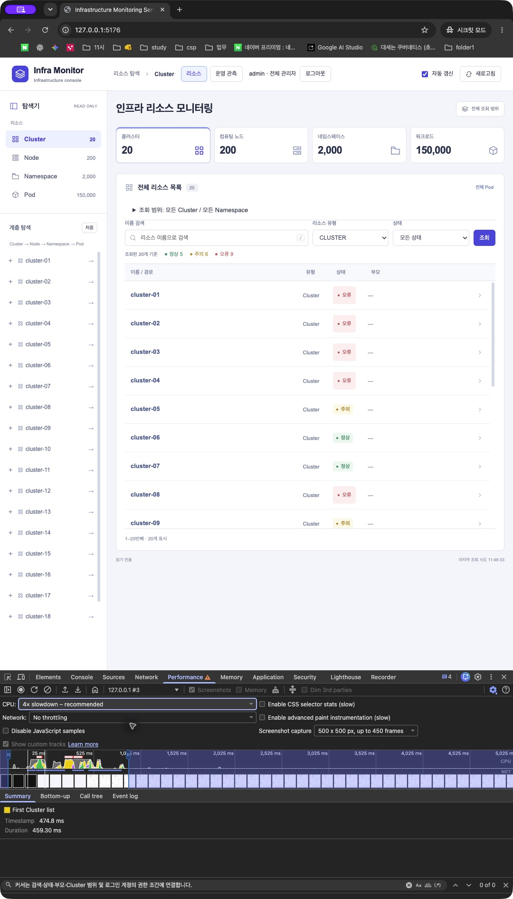
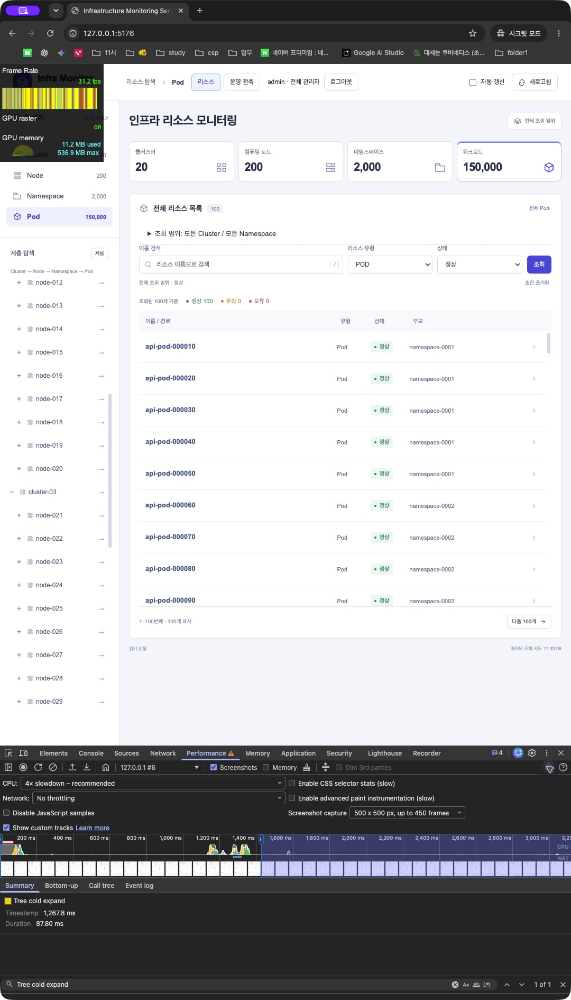
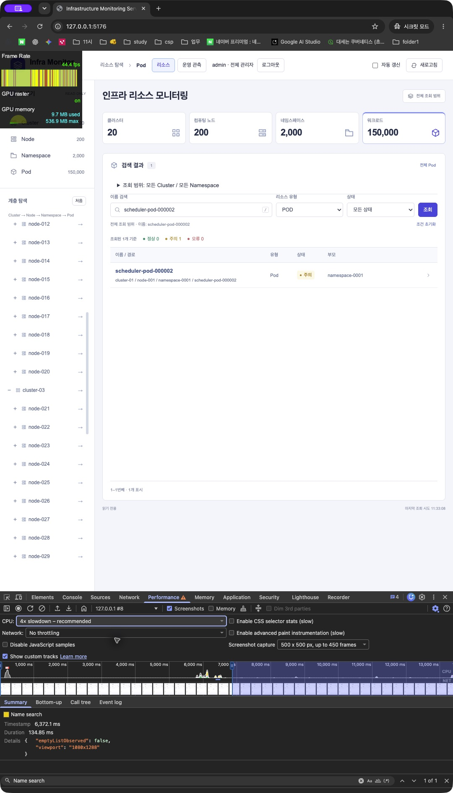
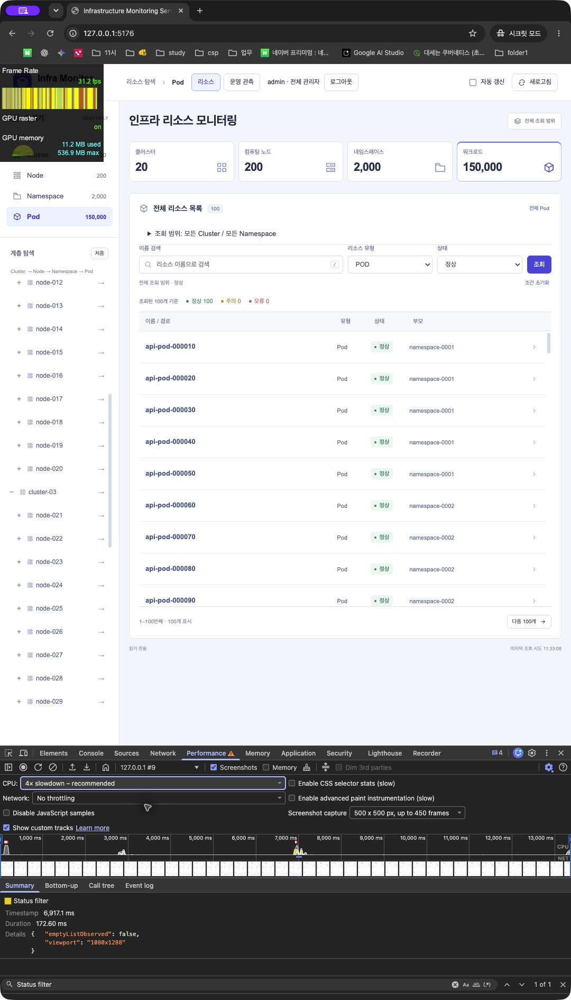

# 초기 렌더링·진단 표시 재검증

2026-10-18 · WH-050 이전 작업 기록. 현재 제출 결과는 [최종 검증](FINAL_PERFORMANCE_REVIEW.md)과 WH-051을 참고합니다.

## 변경 사항

- GPU·리소스 진단·이벤트·화면 머리말의 반복적인 생성 데이터 배지를 제거했습니다. 운영 지표의 상태 갱신 항목과 경보 제목도 사용자 기능 이름으로 바꿨습니다. 내부 metric·규칙 이름과 데이터 생성 경로는 유지합니다.
- Node CPU/메모리 요청량의 라벨을 구분했습니다. 두 값은 현재 Node 행의 저장값이며 하위 컨테이너의 합계는 아닙니다.
- 소수 MiB 사용량을 정수 건수로 검사해 빈 값으로 보이던 오류를 수정했습니다. 예를 들어 6,553.6MiB는 6.4GiB로 표시합니다.
- 첫 Cluster 목록이 그려진 뒤 두 RAF를 지나 사용자 표시 정보·계층 루트·전체 건수를 조회합니다. 인증 토큰·서버 권한 검증은 모든 리소스 요청에서 그대로 적용합니다. App 청크를 동적 import하는 실험은 지연 증가가 관측돼 되돌렸습니다.
- 첫 화면·계층 동작의 User Timing은 고정 이름만 사용하고 이전 measure를 지워 누적량을 제한합니다. 검색·필터·갱신용 DOM observer는 테스트 세션에만 사용합니다.

## 실제 Chrome Performance

Chrome155.0.8059.80, CPU4×, 캐시 비활성, 네트워크 제한 없음, 관리자·150,000 Pod, 1080×1288에서 직접 기록했습니다. 첫 화면은 최종 인증 복귀 문서의 navigation부터 실제 Cluster 목록 표시까지이며 앞선 SSO 왕복은 포함하지 않습니다.

| 동작 | 값(ms) | 범위 |
|---|---:|---|
| 첫 Cluster 목록 | 459.30 | 현재 정적 App·사용자 표시 정보 지연 로딩의 개별 성공 기록 |
| 최초 펼침 | 64.30 / 59.00 / 87.80 | 서로 다른 미조회 Cluster 세 개, 네트워크 포함 |
| 검색 | 134.85 | 디바운스 이후 요청부터 실제 결과 표시 |
| 상태 필터 | 172.60 | select change부터 정상 상태 결과 표시 |

이전 성공한 재펼침48.40·접기37.98·수동57.96·변경 수동122.10·변경 자동75.90ms 원본은 [이전 측정](CHROME_PERFORMANCE_CAPTURE.md)에 있습니다. 해당 뷰포트는 1080×1769이며 최신 첫 화면과 하나의 반복 통계로 합치지 않습니다.

## 반복 결과와 미완료

첫 작업 순서 분리 후 초기 GUI 세 번은458.30·464.70·454.80ms였지만, 추가 확인576.10ms가 나왔습니다. 사용자 표시 정보까지 뒤로 미룬 최종 정적 App에서는459.30ms와844.40ms를 기록했습니다. 따라서 개별 성공 캡처는 확보했지만 첫 화면의 반복 안정성은 미완료입니다. 이 기록은 삭제하거나 성공 통계에서 조용히 제외하지 않습니다.

중간 headless20회 `readme-recheck-20261018`에서는 SSO 복귀514.82ms 1건, 자동 변경 갱신339.10ms 1건이 목표를 넘었습니다. 나머지 화면 지연 목표는 초과0이며 API 오류·측정 오류0, fixture 복원 성공입니다. 당시 native trace 조회/캡처가 일부 겹쳐 호스트 부하의 영향을 배제할 수 없습니다. 원인은 아직 확정하지 않았습니다.

후속 `staged-identity-final-20261018`20회에서는 SSO 최대387.12ms, callback231.30ms, 검색66.70ms, 필터106.10ms, 수동61.80ms, 변경 수동75.30ms, 변경 자동88.00ms로 각각 목표 초과0이었습니다. 최초 펼침은 P95 61.00ms이나 최댓값176.40ms로1회 초과했습니다. API/측정 오류0·fixture 복원 성공이며 브라우저는155.0.8059.85, 1440×1000 headless입니다. [전체 분포](performance/2026-10-18-staged-identity.json)를 보관하며 native GUI의155.0.8059.80과 구분합니다. 모든 반복이 성공했다고 주장하지 않습니다.

검색615.88ms는 tracing 초기화 중 동작이 시작돼 타임스탬프가 녹화 시작보다 앞선 준비 간섭 기록입니다. Tracing 상태를 확인한 후134.85ms로 측정했습니다. 스크롤 첫 시도는 콘솔 문법 오류로 실행되지 않았고 수정 후 실제 스크롤을 확인했습니다. Protocol Monitor drawer가 Duration을 가린 초기 이미지들은 최종 수치 증거로 채택하지 않습니다.

15초 스크롤 중 Chrome FPS 미터 세 시점은91.2·97.2·96.0fps입니다. 별도의 RAF 계측은15,008.5ms/1,316프레임, 평균87.68fps, 1초 구간 최저69fps였습니다. RAF는 native FPS 미터가 아니며 세 캡처만으로 미터의 전 구간 최솟값을 증명하지 않습니다. 이전 탭 작업관리자90.8MB는 별도 시점입니다.

## 검증 및 운영 경계

프론트109개·TypeScript/프로덕션 빌드, 최종 이미지의 실제 Keycloak E2E14개(skip/unexpected/flaky0)를 통과했습니다. 초기 작업 성능을 측정한 정적 App 이미지 ID는 `503034168b13134708bcf0ecbc953642224766de24c6cd25be52ec7cfc959f42`입니다. 이후 기존 이벤트의 기본 문구 표시만 수정한 최종 배포 이미지는 `dfbeab469d65abccc31edd304073cfd2d58e59e11da24e7e8c41b245dd35c0fa`이며, 초기 작업·계층 코드는 동일합니다. seed 문구 변경 후 실제 PostgreSQL 스키마/15만 적재 통합 테스트1개(failure/error/skip0)도 통과했습니다. 백엔드·스키마 변경은 없고 기존 DB/계정/볼륨을 유지했습니다. 측정용 시크릿 창은 닫았고 토큰·인증 코드·raw HAR/trace는 공개하지 않았습니다. AI·임베딩·외부 SMTP 호출은 없습니다.
