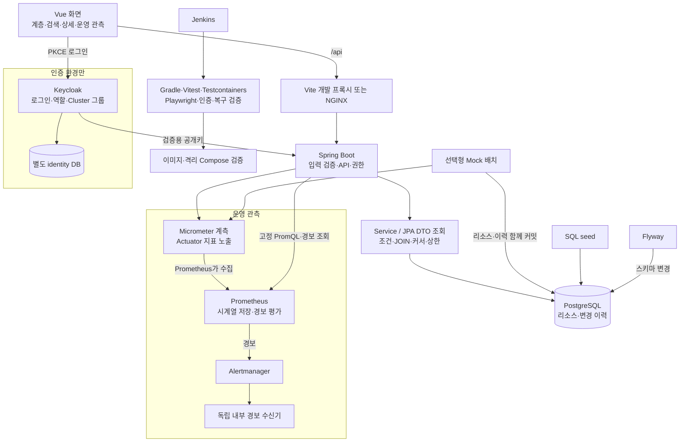
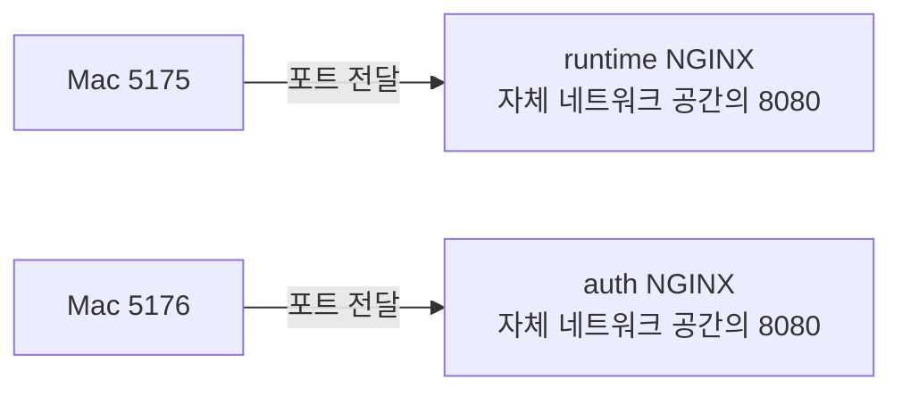
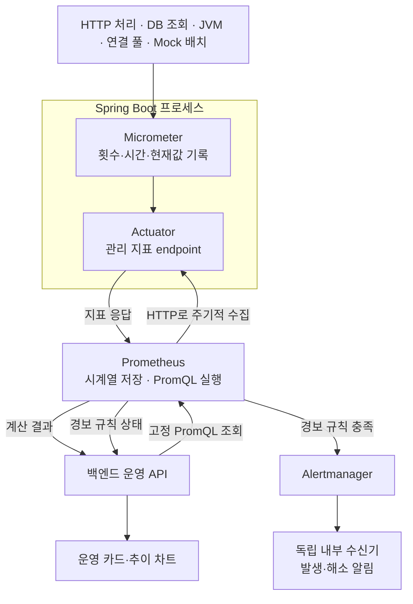

# 전체 구성과 대용량 데이터 처리 해설

확인일: 2026-10-17 · OSC 기술 과제용 독립 프로젝트

## 1. 전체 논리 구성

아래는 한 실행 환경의 논리 구조입니다. 호스트 개발/runtime/인증 환경이 하나의 DB를 공유한다는 뜻은 아닙니다. 인증 블록은 인증 환경에만 적용합니다. 리소스는 Mock 데이터이며 실제 Kubernetes에는 연결하지 않습니다.



화면의 `/api` 요청에는 인증 환경에서 메모리의 Bearer 토큰을 붙입니다. 백엔드는 검증된 토큰의 client role·그룹으로 DB 조건을 제한합니다. Keycloak은 매 API 요청마다 비밀번호를 확인하는 중계 서버가 아니며 공개키는 캐시될 수 있습니다. Jenkins 검증 환경도 사용 중인 세 환경과 분리합니다.

## 2. 15만 건을 매 요청마다 메모리 순회하지 않는 방법

1. seed SQL이 Cluster 20/Node 200/Namespace 2,000/Pod 150,000개를 실제 PostgreSQL 테이블에 적재합니다. 생성 스크립트는 서비스 조회와 별개입니다.
2. Cluster → Node → Namespace → Pod는 외래키로 연결합니다. 이 관계는 과제의 드릴다운 모델이며 실제 Kubernetes 오브젝트 관계와 구분합니다.
3. API는 유형·부모·이름·상태·권한 조건을 SQL에 넣습니다. Java에서 전체 행을 읽어 필터링하지 않습니다.
4. JPA DTO projection과 JOIN으로 필요한 열/경로를 읽고 목록/검색 최대 100개를 반환합니다. 다음 페이지 여부 판단을 위한 내부 반환량은 최대 101개입니다. 전체 유형 검색도 네 유형 합산 101개까지만 읽습니다.
5. 다음 페이지는 `id > 마지막 ID`의 keyset 조건을 사용합니다. 인덱스 기반 탐색을 지원하고 큰 OFFSET으로 앞부분을 계속 버리는 방식을 피합니다.
6. 트리는 펼친 부모의 직속 자식 페이지를 그때 조회합니다. 검색 결과의 상위 경로도 반환하므로 전체 트리를 로드해 경로를 찾지 않습니다.
7. 총건수는 DB의 COUNT 집계로 받고 초기/명시적 갱신 때만 요청합니다. 행 전체를 Java로 받아 개수를 세지 않습니다.

아래는 조회 논리를 단순화한 SQL 예시이며 실제 Hibernate SQL에는 DTO/상위 경로용 JOIN·권한 조건이 포함됩니다.

```sql
SELECT id, name, status, updated_at
FROM infrastructure_pod
WHERE namespace_id = :namespaceId
  AND id > :afterId
ORDER BY id
LIMIT 101;
```

부모+ID, 상태+ID, 부모+상태+ID 인덱스와 pg_trgm 이름 GIN 인덱스를 사용합니다. **반환량이 제한된 것과 DB가 확인하는 행 수가 항상 101개라는 것은 다릅니다.** 검색어 선택성에 따라 순차 스캔이 가능하며 COUNT도 DB가 행/인덱스를 확인합니다. PostgreSQL 버퍼 캐시는 DB의 정상 동작으로, 애플리케이션에서 전체 계층을 메모리 순회하는 방식과 다릅니다.

## 3. 세 포트는 서로 다른 실행 인스턴스

인증 환경의 DB 프로세스는 2026-10-18부터 한 개입니다. 내부 `db:5432`에 `monitoring`·`identity` DB를 두고 전용 비관리자 계정/접속 권한을 분리합니다. 상시 컨테이너는 7개이고 개발/runtime의 DB와는 여전히 독립적입니다. [선택 이유·백업 이행·복구](SHARED_AUTH_DATABASE.md)를 참고합니다.

| 호스트 화면 | 화면 제공 | API 처리 | 앱 DB | 인증 |
|---|---|---|---|---|
| 5174 | Mac의 Vite 개발 서버 | Mac의 Java 8081 | 개발 Compose DB, 호스트 5544 | 없음 |
| 5175 | runtime의 NGINX 내부 8080 | runtime backend 내부 8081, 호스트 8082 | runtime 전용 볼륨, 호스트 포트 없음 | 없음 |
| 5176 | auth의 NGINX 내부 8080 | auth backend 내부 8081, 호스트 8083 | auth 전용 볼륨, 호스트 포트 없음 | Keycloak 호스트 8183/내부 8080 |

5174는 `frontend/package.json`의 개발 명령이 선택한 포트입니다. 5175/5176은 Compose의 `호스트 포트:컨테이너 포트` 매핑입니다. `5175:8080`은 Mac의 5175 요청을 해당 NGINX 컨테이너의 8080으로 전달합니다. 컨테이너는 네트워크가 격리되어 내부에서 같은 8080/8081을 사용해도 충돌하지 않으며, 호스트에 공개하는 포트만 서로 다르게 지정합니다.

브라우저는 화면과 같은 출처의 `/api`를 요청하고 Vite 또는 NGINX가 백엔드로 프록시합니다. NGINX는 내부 `backend:8081`로 전달하며 호스트 8082/8083을 다시 거치지 않습니다. 서비스명 `backend`도 각 Compose 프로젝트의 별도 네트워크에서 해석됩니다.

인증 화면은 `VITE_AUTH_ENABLED=true`로 별도 빌드합니다. 기존 정적 이미지는 파일 수정만으로 바뀌지 않습니다. 최신 반영에는 이미지 재빌드/컨테이너 교체가 필요하며 같은 프로젝트의 다른 실행 모드가 자동 동기화되지는 않습니다. 세 환경은 이중화/로드밸런싱 구성이 아닙니다.

### 현재 상태와 계정

읽기 전용 확인에서 세 화면 HTTP 200, Keycloak 루트 HTTP 302, 인증 API의 토큰 없는 호출 HTTP 401을 확인했습니다. 개발 건수 API 및 runtime/auth 앱 DB 모두 Pod 150,000개입니다. 다만 runtime의 현재 이전 이미지에는 경보 API가 없어 `/api/operations/alerts`가 404입니다. 화면 접속 성공을 모든 최신 기능 반영으로 해석하지 않습니다. 이번 설명 작업에서는 이미지를 교체하지 않았습니다.

서비스 계정은 `admin`(전체·운영 관측), `user1`(Cluster 1~10·100,000개), `user2`(11~20·50,000개)입니다. 이전 계정의 사용자 ID/sub·비밀번호·role/group은 유지한 이름 변경입니다. Keycloak 관리 콘솔 초기 계정 `kc-bootstrap`은 서비스 admin과 별개입니다. Realm은 `infrastructure-monitoring`입니다. 비밀번호는 Git 제외 `.local/auth/credentials.json`에 보관하고 파일 권한은 0600입니다. 최초에는 랜덤 생성하며 현재 로컬 세 계정만 사용자 요청의 공통 데모 비밀번호를 유지합니다. 값은 문서/출력에 남기지 않습니다. Keycloak 계정/권한 정보는 별도 identity DB에 영속화하며 초기 설정 파일이 실제 로그인 DB를 대신하지 않습니다. [계정·분포·로그인 테마와 이행](USER_SCOPES_AND_LOGIN_THEME.md)을 참고합니다.

첫 구성 확인은 서버 재시작/계정 초기화 없이 수행했고 이후 세 서비스 계정의 비밀번호만 별도 변경했습니다. DB/Realm 초기화는 하지 않았습니다. 실행 명령과 보안 경계는 [README](../README.md), [인증 문서](AUTHENTICATION.md)를 참고합니다.

## 5. 제출 시연 경로와 컨테이너 포트

과제 문서는 특정 포트나 Keycloak을 강제하지 않습니다. 전체 구현 시연은 5176의 서비스 ADMIN, 핵심 탐색/일반 컨테이너 재현은 5175로 구분해 안내할 수 있습니다. 이는 제출 안내 제안이며 아직 최종 제출 패키지/대표 명령을 교체한 것은 아닙니다. 평가자가 자기 PC에서 실행할 수 있는 소스·명령·검증 조건이 제출물이며 개발 Mac의 localhost 주소는 외부 접속 주소가 아닙니다. 최종 제출 전 현재 소스/커밋으로 이미지를 다시 빌드하고 해당 환경을 재검증해야 합니다.

현재 runtime의 경보 영역/API가 없는 이유는 예전 이미지가 남아 있기 때문이지 비인증 모드 정책 때문이 아닙니다. 최신 코드의 OperationsDashboard는 로컬 비인증 모드에서도 OperationsAlerts를 렌더링하고 API도 허용합니다. 인증 모드에서는 ADMIN만 허용합니다. 사용 중인 runtime은 이번 설명 작업에서 재빌드하지 않았습니다.

후속 읽기 전용 확인에서 runtime의 Prometheus 경보 규칙은 0개이고 실행 컨테이너는 frontend/backend/db/prometheus뿐입니다. 따라서 이전 이미지뿐 아니라 경보 추가 전 실행 구성도 남아 있습니다. 최신 frontend만 바꾸는 것이 아니라 전체 Compose의 경보 규칙/Alertmanager/수신기를 함께 기동해 검증해야 합니다.



같은 Mac 주소/포트로 두 서버가 동시에 대기할 수는 없습니다. 하지만 각 컨테이너는 자체 IP/네트워크 네임스페이스에서 대기하므로 내부 8080을 각각 사용할 수 있습니다. 같은 Docker bridge 네트워크에 속해도 컨테이너별 주소/네임스페이스는 다르며 이 프로젝트는 Compose 네트워크도 분리합니다. host 네트워크처럼 주소 공간을 공유하는 특수 구성을 일반화하지 않습니다. Mac의 Docker Desktop에서는 이 컨테이너들이 Linux VM 안에서 실행됩니다.

## 6. API마다 Keycloak을 호출하나요?

5176 인증 모드는 매 보호 API 요청마다 Spring Security가 Bearer JWT를 검증하지만 Keycloak에 매번 사용자/권한을 물어보지 않습니다.

1. 브라우저가 Keycloak에서 PKCE로 로그인해 토큰을 받습니다.
2. 일반 요청에는 토큰을 붙여 앱 API에 보냅니다.
3. 백엔드는 공개키로 서명·issuer·audience·만료·sub·claim 형식을 검증합니다. 공개키 캐시가 없거나 키가 바뀌면 JWKS 조회가 필요할 수 있습니다.
4. 검증한 토큰의 `monitoring-api` client role과 `cluster-N` 그룹으로 API 접근/DB WHERE 조건을 결정합니다.
5. 브라우저 어댑터는 요청 전 토큰 갱신을 확인하지만 `updateToken(30)`은 항상 HTTP 요청을 하는 것이 아니라 유효 기간이 부족할 때 Keycloak으로 갱신합니다.

권한을 변경해도 기존 토큰의 claim은 즉시 바뀌지 않습니다. 현재 Access Token 수명 120초와 검증 시간 여유를 고려해야 하며 새 토큰/재로그인으로 반영합니다. 비밀번호 변경이나 로그인 세션 종료를 모든 기존 JWT의 즉시 폐기로 설명하지 않습니다. 기본 5174/5175는 별도 비인증 로컬 모드입니다.

## 7. 계측·수집·조회·경보의 연결



PromQL은 Prometheus에 저장된 시간별 지표를 선택·집계하는 조회 언어입니다. PostgreSQL 업무 테이블을 조회하는 SQL과 다릅니다. `sum(jvm_memory_used_bytes{job="infrastructure-api",area="heap"})`은 heap 사용 바이트 합계, `sum(increase(http_server_requests_seconds_count{job="infrastructure-api",uri=~"/api/resources.*"}[5m]))`은 최근 5분 리소스 요청 증가량 추정입니다. P95는 Histogram 버킷과 `rate`/`histogram_quantile`로 계산합니다. 화면은 임의 PromQL 입력 대신 서버의 고정 허용 목록을 사용합니다. `up`은 애플리케이션에서 기록하는 업무 지표가 아니라 Prometheus가 수집 성공 여부를 기록하는 지표입니다.

Micrometer의 프로세스 메모리 내 계측/Actuator의 현재 지표 노출과 Prometheus의 지속 수집·과거 시계열 저장·범위 통계·경보 평가를 구분합니다. `up=0`은 수집 실패, `absent(up{job=...})`는 대상 up 시계열 자체 없음입니다. 성공한 수집의 업무 요청 수가 0이거나 특정 계측 항목이 없다는 뜻은 아닙니다. 유효한 빈 지표 응답도 up=1일 수 있어 개별 필수 지표 누락은 현재 규칙의 범위 밖입니다. 내부 수신기는 `/events`로 이벤트를 제공하지만 외부 포트/별도 사용자 수신함/메일을 제공하지 않습니다. ADMIN 운영 경보 화면은 Prometheus 상태이며 전달 이력 화면과 다릅니다. 상세 설명은 [학습 7·8번](STUDY_QUESTIONS.md)에 이어집니다.

운영 경보 화면은 Prometheus 규칙 상태를 읽습니다. Alertmanager의 알림 전달 여부/기록을 화면에서 직접 읽는 것은 아닙니다. 7번 학습의 구체적인 경보·그룹화·억제·복구는 [질문 목록](STUDY_QUESTIONS.md), 구현 정책은 [운영 경보 문서](ALERTING_AND_RECOVERY.md)를 참고합니다. 일반 정의의 공식 근거는 [PromQL](https://prometheus.io/docs/prometheus/latest/querying/basics/), [경보 개요](https://prometheus.io/docs/alerting/latest/overview/)입니다.

## 4. 코드 근거

- 저장 구조/인덱스: [V1](../backend/src/main/resources/db/migration/V1__resource_hierarchy.sql), [V2](../backend/src/main/resources/db/migration/V2__resource_query_indexes.sql), [seed](../scripts/seed.sql)
- 제한 조회/DTO: [ResourceRepository](../backend/src/main/java/dev/infrastructure/monitoring/resource/ResourceRepository.java), [JPA 설계](JPA_QUERY_DESIGN.md)
- 포트/프록시: [개발 Compose](../compose.yaml), [runtime](../compose.runtime.yaml), [인증](../compose.auth.yaml), [Vite](../frontend/vite.config.ts), [NGINX](../frontend/nginx.conf)
- 화면 자원 관리: [VirtualList](../frontend/src/components/VirtualList.vue), [virtualRange](../frontend/src/virtual.ts), [목록 캐시](../frontend/src/useResourceList.ts), [계층 캐시](../frontend/src/components/ResourceTree.vue)
- 지표: [관리 endpoint 설정](../backend/src/main/resources/application.yaml), [조회 계측](../backend/src/main/java/dev/infrastructure/monitoring/resource/ResourceService.java), [운영 설계](OPERATIONS_AND_DELIVERY.md)
- 이어서 학습할 내용: [질문 5·6번의 가상 리스트·Actuator/Micrometer](STUDY_QUESTIONS.md)
