> WH-050까지의 이전 검증 기록입니다. 현재 제출 결과는 [최종 성능 보고서](../FINAL_PERFORMANCE_REVIEW.md)를 참고합니다.

# Chrome DevTools Performance 원본 캡처

## 최신 재검증

WH-050의 UI·초기 작업 순서 변경 후 기록과 원본 이미지는 [재검증 보고서](../PERFORMANCE_RECHECK.md), [수치 JSON](../performance/2026-10-18-native-recheck.json)에 있습니다. 첫 화면459.30ms·미조회 계층87.80ms·검색134.85ms·필터172.60ms의 개별 성공 캡처를 확보했습니다. 첫 화면 반복 초과도 남아 있으므로 전체 반복 성공으로 확대하지 않습니다. 첫 화면/계층은 제품의 bounded User Timing, 검색/필터/갱신은 테스트 전용 observer로 계측합니다.

## WH-049 당시 판정

2026-10-18 **실제 Chrome 155.0.8059.80의 Performance 탭**에서 다시 기록했습니다. 이전 목표별 요약 PNG는 자동 측정 JSON을 시각화한 그림이며, 가이드가 요청한 DevTools 원본 증거를 대신하지 않습니다.

최초 화면은 658.10ms로 500ms를 넘었습니다. 최초 펼침은 278.72ms였으며 이때 측정 중 접근성 트리 조회가 겹쳤습니다. 제품 처리와 계측 간섭을 분리한 재검증이 필요하고, 캐시 재펼침의 48.40ms를 최초 펼침 결과로 바꾸지 않습니다. FPS 미터는 스크롤 중 순간 관측만 확보했습니다. **전체 목표 충족 판정은 아직 미완료입니다.**

## 조건

| 항목 | 실제 기록 조건 |
|---|---|
| 기기 | Apple M1 Pro·16GB |
| Chrome | 155.0.8059.80 공식 arm64, Chrome 정보에서 최신 확인 |
| 대상 | 인증 Compose 프로덕션 화면, 관리자, PostgreSQL 150,000 Pod |
| CPU·캐시 | DevTools CPU 4× slowdown·Disable cache 체크 |
| 네트워크 | 속도 제한 없음 |
| 화면 | 기본 1080×1769, 최초 진입 추가 확인만 1440×1000 |
| 원본 | Chrome 창 JPEG, 수치·타임라인 편집 없음 |
| 반복 통계와의 차이 | 선택 이벤트별 캡처 1건, P95·반복 성공률이 아님 |

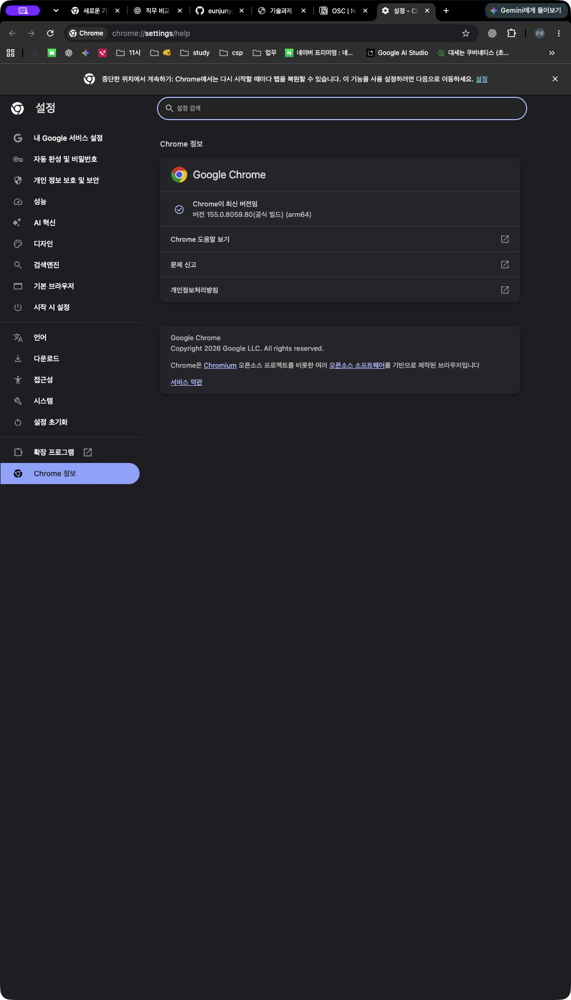
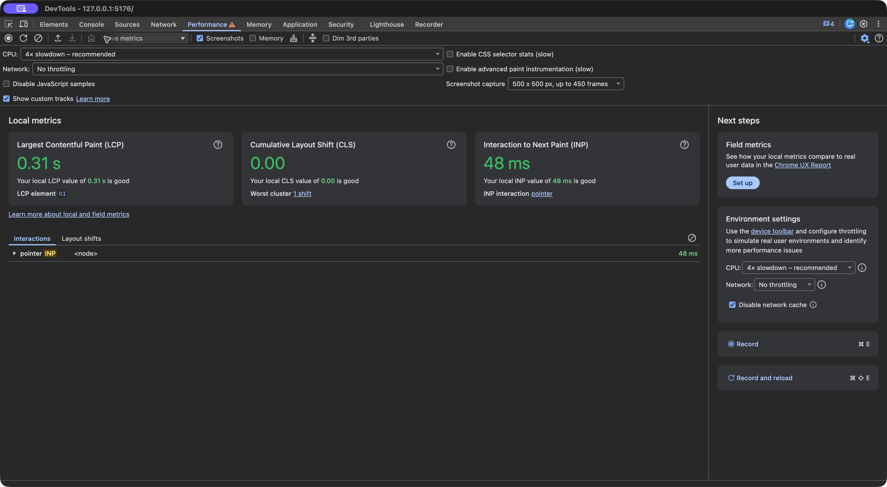

## 측정 경계

테스트 전용 [User Timing 도구](../../frontend/scripts/devtools-user-timing.mjs)는 서비스 번들에 포함하지 않습니다. 로컬 페이지에만 붙여 fetch 요청과 실제 DOM 결과를 확인하고 두 animation frame 뒤 measure를 마칩니다. API 응답을 다시 파싱하거나 인증을 우회하지 않습니다.

- 최초 화면: 최종 인증 복귀 문서 navigation 시작(0) → 실제 Cluster 목록. 앞선 Keycloak 왕복은 포함하지 않습니다.
- 펼침·접기: 실제 클릭 → 대상 Node 표시/제거. 캐시 상태를 별도로 구분합니다.
- 검색: 디바운스 이후 해당 검색 요청 시작 → 해당 이름의 실제 결과 표시.
- 필터: native select의 change → 상태가 일치하는 결과 표시. 메뉴를 여는 시간은 제외합니다.
- 수동 갱신: 앱의 새로고침 클릭 → 요청 그룹 완료와 표시. 브라우저 자체 reload와 다릅니다.
- 변경 갱신: DB 테스트 Pod 1의 상태·시각 변경 → 목록/선택 상세 배지 일치. 자동 갱신은 첫 목록 요청에서 시작하며 폴링 주기 대기는 제외합니다. 원래 상태·시각 복원 성공을 확인했습니다.
- 두 RAF는 그릴 기회를 확인하는 방법이며 물리 화면 표시 시점의 광학 측정은 아닙니다.

## 목표별 Performance 원본

### 1. 최초 Cluster 목록: 658.10ms / 목표 500ms

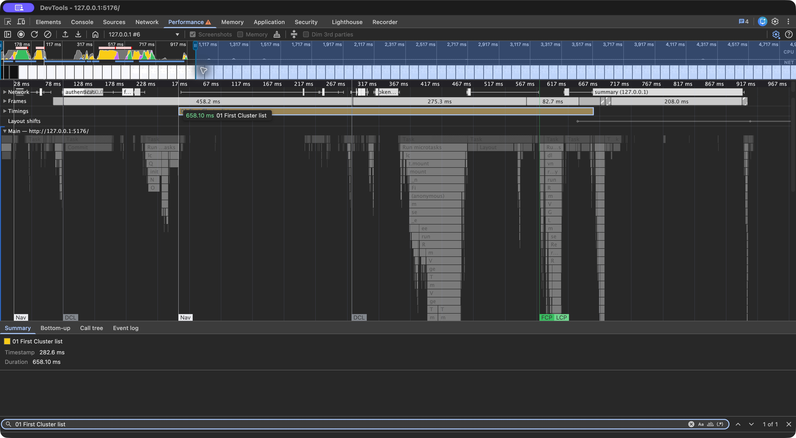

1440×1000에서도 619.13ms였습니다. 화면 크기를 바꾼 기록은 같은 표본 집계로 섞지 않습니다.

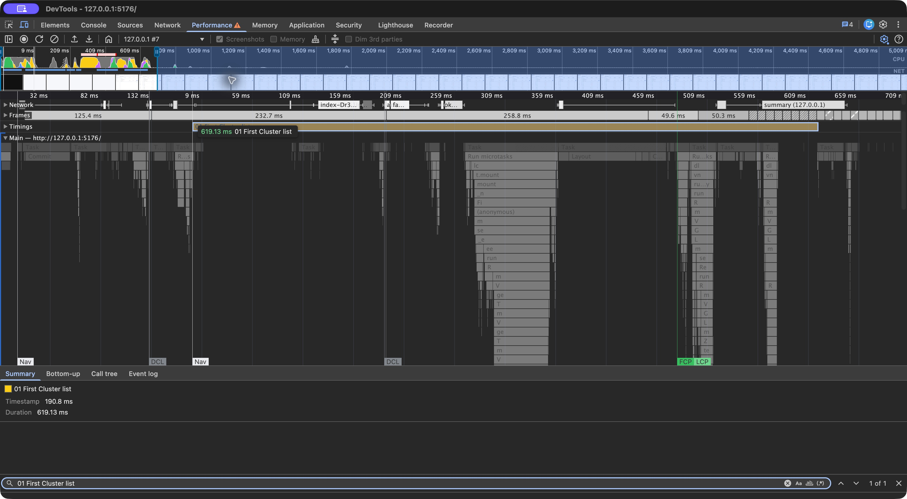

### 2. 계층 펼침·접기: 목표 100ms

최초 펼침은 278.72ms(계측 중 접근성 조회 동반), 캐시 재펼침은 48.40ms, 접기는 37.98ms입니다. 최초 펼침의 간섭 원인은 아직 확정하지 않았습니다.

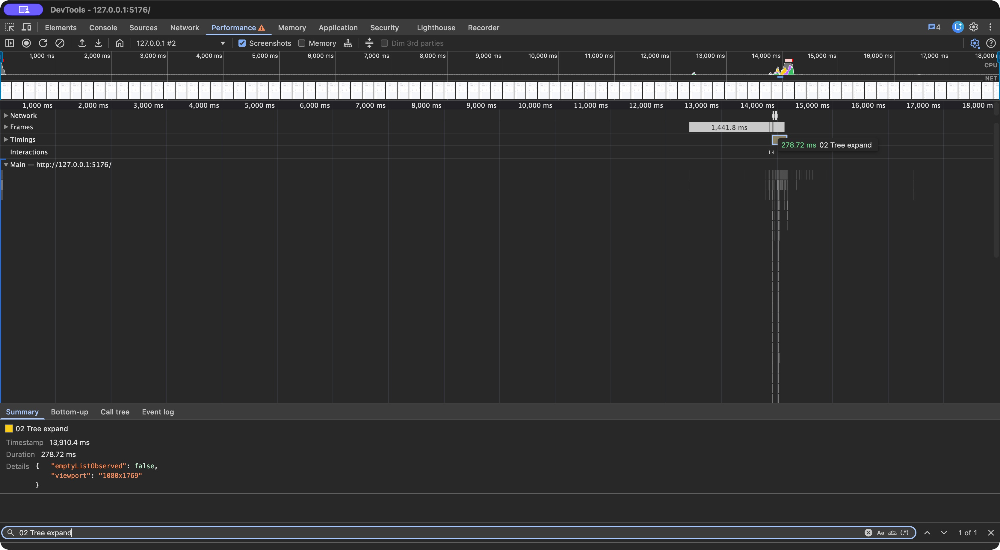
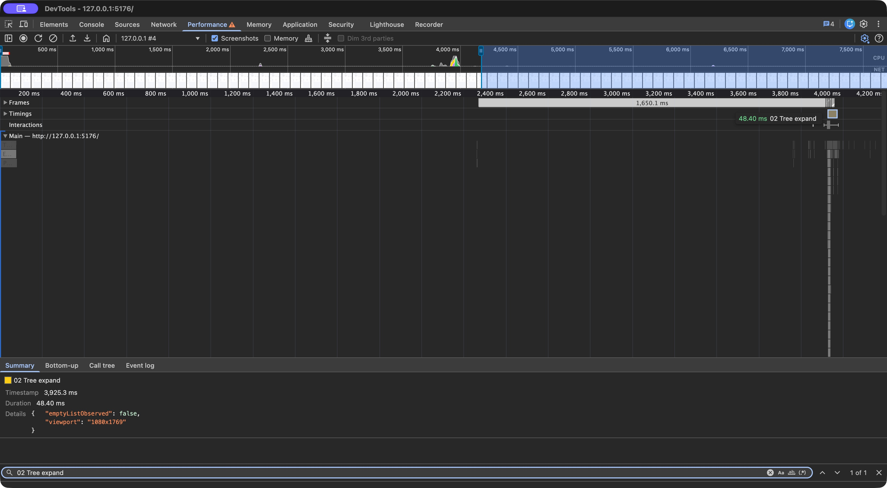
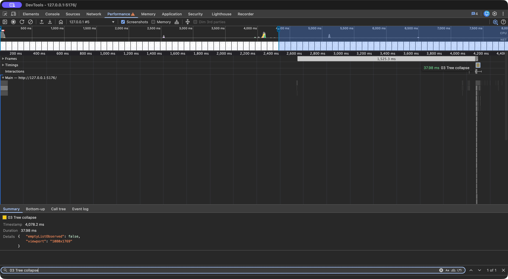

### 3. 검색: 142.32ms / 목표 300ms

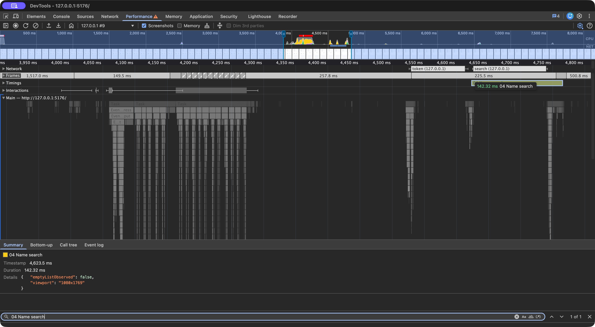

### 4. 상태 필터: 138.65ms / 목표 200ms

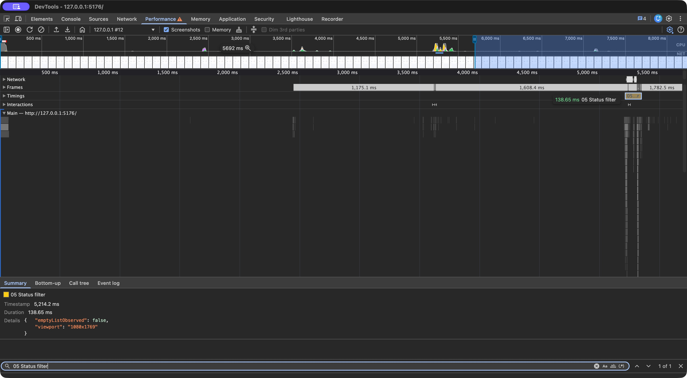

### 5. 수동·자동 갱신: 목표 200ms

변경 없는 새로고침 57.96ms, 변경 반영 새로고침 122.10ms, 자동 변경 반영 75.90ms입니다. 두 변경 기록의 Details에서 `emptyListObserved: false`를 확인합니다. 이는 목록 공백 감시 결과이며 모든 종류의 시각적 깜빡임을 완전히 배제하는 증거는 아닙니다.

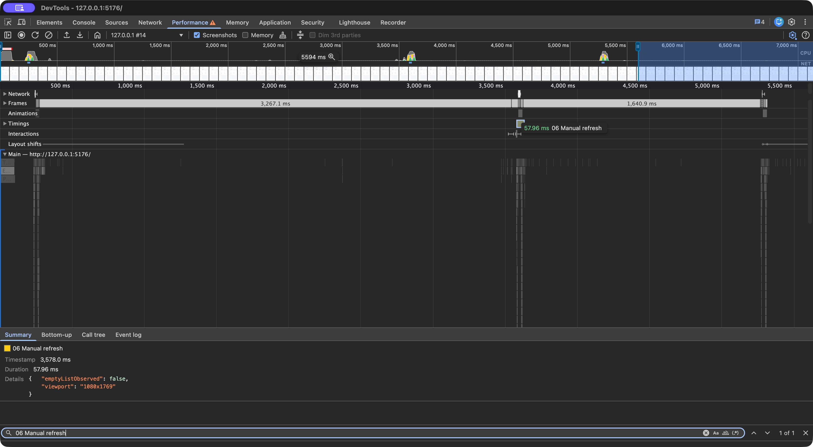
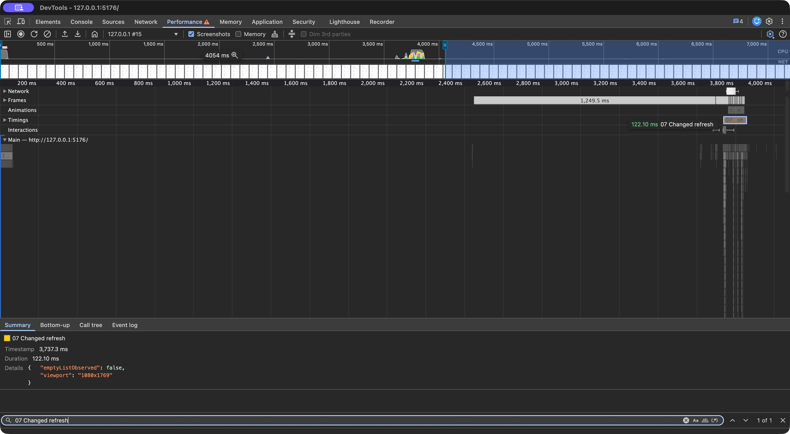
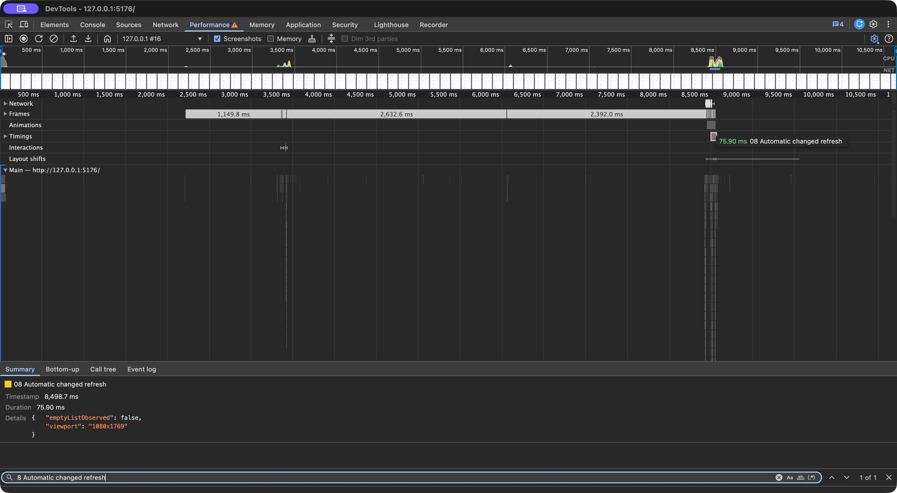

### 6. 스크롤: 목표 55fps 유지

15만 Pod 조회 화면에서 최근 500개 창을 유지하며 네이티브 휠을 약 19.2초 조작한 실제 Performance 기록입니다. Frames·Main 타임라인을 보관합니다. 자동 다음 페이지 로드가 포함될 수 있으며 15만 DOM을 한 번에 만든 시험은 아닙니다.

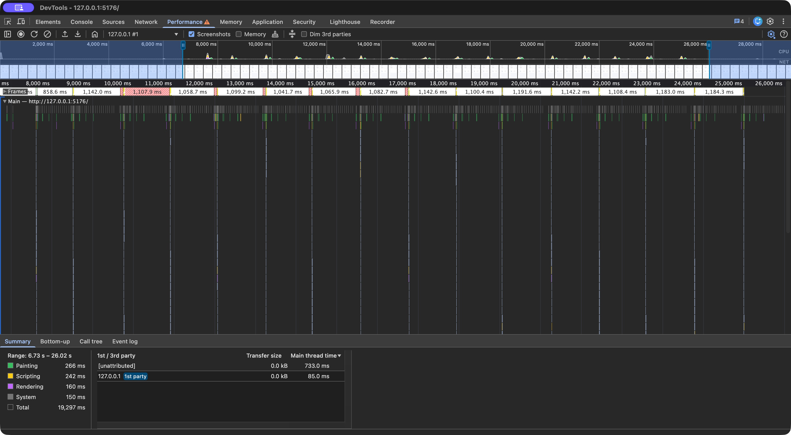

별도 RAF 기반 스크롤 중 Chrome 기본 Frame rendering stats가 91.2fps를 표시한 순간을 캡처했습니다. **단일 스냅샷은 전체 구간의 최저 FPS를 입증하지 않습니다.** 기존 CDP 59.97fps와 동일 실행으로 혼합하지 않습니다.

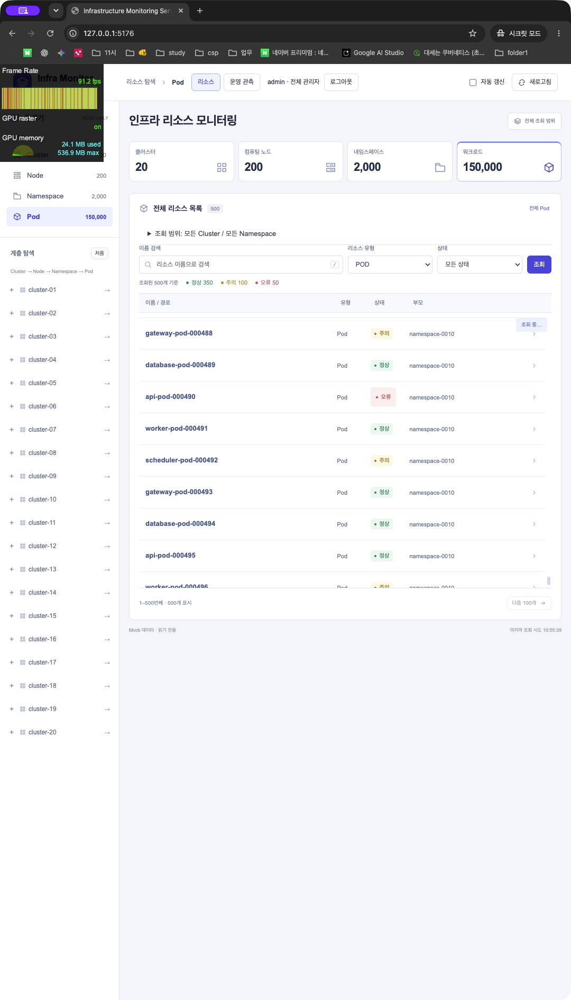

### 7. 메모리: 참고 목표 300MB

Chrome 작업관리자의 대상 시크릿 탭은 90.8MB였습니다. DevTools가 열린 별도 관측 시점입니다. DevTools 프로세스 메모리나 전체 Chrome 합계와 구분합니다.

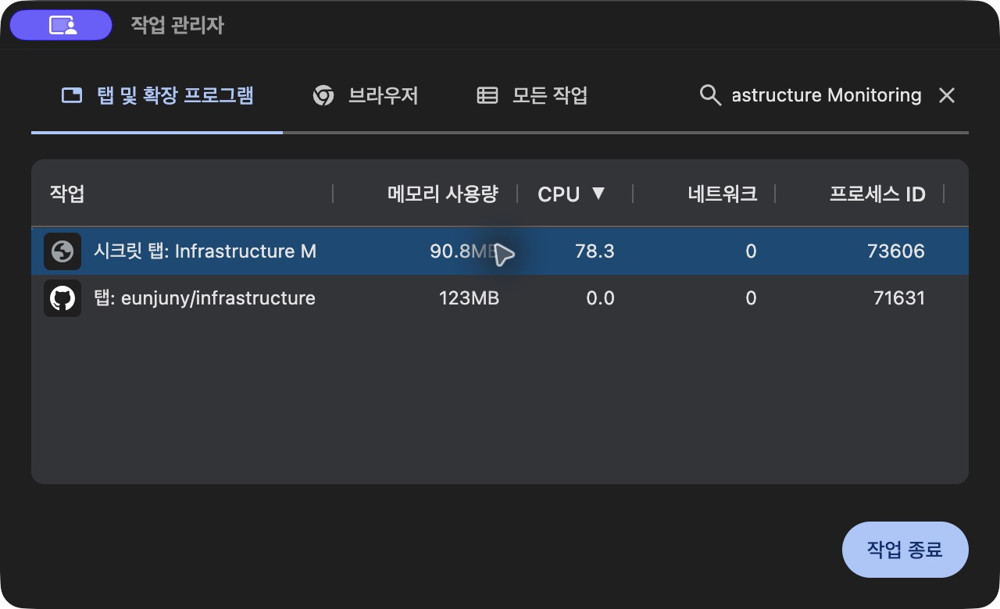

## 다시 캡처하는 순서

1. 관리자 로그인 후 로컬 프로덕션 화면에서 새 기록을 준비합니다.
2. Performance의 CPU를 4×로, 네트워크 캐시를 비활성화합니다. 코드 다운로드 캐시와 앱의 계층 캐시는 구분합니다.
3. Console에 테스트용 도구를 붙이고 해당 동작을 arm합니다. 최초 진입은 DevTools Protocol Monitor의 Main 대상에 `Page.addScriptToEvaluateOnNewDocument`로 source를 등록해야 새 문서에도 유지됩니다. Protocol Monitor 자체 로그 기록은 끄고 닫습니다.
4. Performance에서 Record 또는 Record and reload를 실행합니다. 측정 구간 중 대상 페이지의 접근성 트리를 별도로 직렬화하지 않습니다.
5. 동작 후 녹화를 종료하고 Find에서 measure 이름을 찾아 Summary Duration과 Timings·Main·Network를 함께 캡처합니다. Find가 기록을 잃거나 처리 중이면 그 이미지를 증거로 채택하지 않습니다.
6. 임시 init script와 도구는 제거하거나 측정 전용 시크릿 창을 닫아 정리합니다. 인증 코드·JWT·헤더가 포함될 수 있는 raw trace/HAR는 공개하지 않습니다.

[원본 수치 목록](../performance/2026-10-18-native-devtools.json), [기존 headless 반복 결과](../FINAL_PERFORMANCE_REVIEW.md), [측정 프로토콜](../PERFORMANCE.md)을 참고합니다. 이전 요약 그림·실패·제약은 작업 이력 WH-048/049에 남깁니다.
